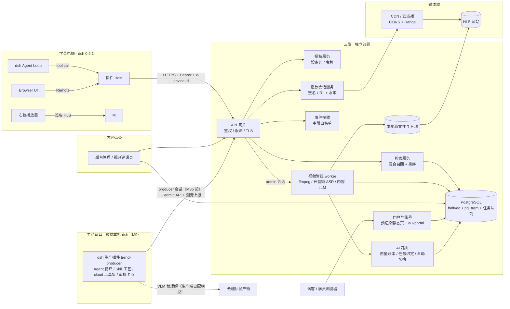
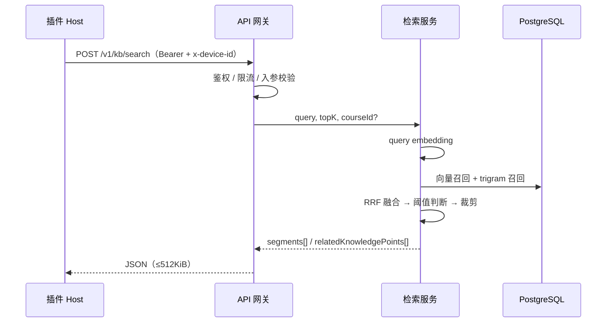
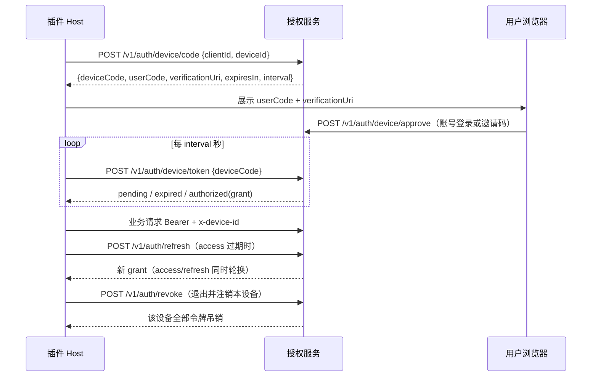

# 趋势课程云端服务 · 架构设计（v0.11）

版本：v0.11（2026-11-06；M3b 契约阻断项批次 B1：新增 `producer` 角色与生产/发布分权——生产命名空间 `/v1/admin/content/*` 接受 operator/admin/producer，发布/审批/账号/模型配置仍限 operator/admin；迁移 015 含 content_approvals 与 course_stock_quotes 表结构）
v0.10（2026-11-05；文档体系梳理：M10 R1 呈现层落地状态回写、§7 小节编号去重（模型配置由重复的「7.1」改为 7.6）、案例股代号双形态统一（DB 6 位数字 + exchange ↔ 正文带前缀形态）、§6.5.4 图示配额改为指向 §6.6.2、跨仓版本引用校正）
v0.9（2026-11-05；采纳「老师标注详情 + 逐根回放判断闭环」增补提案（来源 producer 调研线 `docs/research/m10-replay-annotation-proposal.md`，评审修正 3 处）：DSL v2 草案增 `:::annotation`/`:::replay`（按 code 解析，不带 widgetId）、`spec_version=2` 批次增 `bar-replay-decision`（3 条新断言、bars 不入 spec）、渲染组件输入扩 `annotations[]`、ADR C33/C34；隐私护栏：学员作答不采集。实现挂 R2 后半/R3 试点，R1 范围不变）
v0.8（2026-11-05；补充 M10 教材呈现层与个股实盘对照目标架构 §6.6：富文本 DSL v1 冻结、关键帧配图卡与 HLS 时间窗片段卡、参数化 SVG 模板取代 Mermaid、案例股清单与课程侧行情缓存、课件新题型草案；依据 2026-11-05 原型 V1–V3 用户验收与需求 v0.8 C14）
状态：**v0.7 为生产架构重构的目标设计稿（M9），v0.8 起追加呈现层目标架构（M10）**。核心变化：课程生产从"单素材转写→单发 prompt 生成"升级为"语料级多模态理解→概念综合→Agent 逐节 grounded 生产→交互课件"；M10 将节教材升级为编辑部式富文本长文（叙事/图示/媒体/实盘四层）。生产大脑外置于 **dsh 生产插件**（`dsh-plugin-trend-producer`，独立仓库），云端保持确定性校验器、存储与发布门禁职责，不内嵌 Agent 循环。学员面接口与既有契约不变。需求 v0.9（C13/C14）与对接清单 v0.8（§3.13/§3.14）已同步本文接口口径；课件 8 类组件 spec schema v1 已冻结（§6.5.5，2026-11-04）；富文本 DSL v1 与 SVG 模板白名单 v1 冻结（§6.6，2026-11-05）；v0.6 新增 M7 公开门户与自助账号、AI 用量账本与任务级模型路由（`/v1/portal/*`、`/v1/admin/ai/*`）；v0.5 补充 M6 公测加固（限流矩阵、内存上限、压测与恢复演练、合规基线）；v0.4 新增 M1 视频→课程管线（本地存储、DB 任务队列、长音频转写、LLM 草稿与人工发布）；v0.3 同步 M3.1/M3.2/M3.3 落地状态；v0.2 新增 M4.2 语音转写（MiniMax ASR）。

## 1. 目标与范围

云端为 `dsh-plugin-trend-coach` 提供**课程知识与内容服务**，不承担推理（学员 BYOK）；课程**生产**由 dsh 生产插件驱动，云端为其提供确定性算力与门禁。

| 提供 | 不提供 |
|---|---|
| Top-K 片段检索（混合召回 + 排序） | 大模型推理 / API Key 托管 |
| 片段元数据与权威起止秒 | 全库正文下发 |
| 短时效签名 HLS 播放会话 | 直链 / 可下载源站地址 |
| 设备码授权与令牌轮换 | 学员侧内容写接口（一期只读） |
| 鉴权指标事件接收（M2） | 第三方分析 SDK |
| 语音转写（M4.2，MiniMax ASR，仅语音→文字） | 学员侧生成式推理 |
| 后台账号、内容管理与索引重建（M3） | 召回评估看板、插件版本与灰度 |
| 视频→课程管线（M1/M8，遗留）：单素材流式上传、单码率 HLS、长音频转写、章节教材与图示草稿、人工发布（M9 上线后作为单素材兜底路径保留） | 多码率 ABR、对象存储、断点续传、自动发布 |
| **语料级课程生产（M9）**：多素材（约 69 集/10 卷/35h）→ 多模态理解产物 source units 存储/检索、概念图谱与术语表、节级教材/图示/课件草稿、生产溯源账本 | Agent 循环内嵌云端（生产大脑在 dsh 生产插件）；自动发布 |
| **交互课件（M9）**：白名单组件 spec 的服务端复检、断言证明记录、管理台渲染预览 | LLM 生成可执行代码；学员侧交互课件生成 |
| **教材呈现层与实盘底座（M10）**：富文本 DSL 的安全校验与组件渲染契约、节级媒体引用（关键帧配图、HLS 时间窗片段）的解析与回溯校验、案例股清单与课程侧行情缓存的存储与供给、SVG 模板图示确定性渲染、老师标注结构化详情与逐根回放判断练习（v2 批次） | 学员端渲染落地（管理台先行，学员端随 `contractVersion=3`）；案例股清单外标的的行情查询；实时行情（仅缓存日线）；学员作答采集（回放判断只做本地反馈）；与 `ai-invest` 的任何数据耦合 |
| 公开门户（体系、功能、安装向导、下载、FAQ）与学员自助注册/个人中心（M7） | 邮件/短信验证、找回密码、客服工单 |
| AI 用量账本、运行链路、任务级主备绑定与自动切换（M7，M9 起承接生产溯源上报） | 学员侧推理、第三方分析 SDK |

**不耦合 `ai-invest`**：独立仓库、独立数据库、独立鉴权与用户体系；不复制其代码、数据或评估集，只借鉴 PostgreSQL `halfvec` + `pg_trgm` + RRF 的技术选型（PRD D2）。

**模型能力边界**：云端只允许 ASR、查询/片段 embedding、管理端内容生产 LLM 与文生图模型（M8 `illustrate` 遗留路径）。**视觉理解（VLM）在生产端自配执行，云端只做抽帧与存储**（§6.5.2）。云端侧生成产物只落 `draft`，必须人工审核并显式发布。**生产 Agent 循环（规划/写作/评审的多轮推理）不在云端执行**——由外部 dsh 生产插件以其自身配置的模型承担，云端只做确定性校验、存储与门禁。连接信息与密钥存数据库（AES-256-GCM 加密），仅 `admin` 在后台维护；明文密钥不进入浏览器、插件、日志或响应。

## 2. 设计原则与约束

1. **业务面边界**：学员只读知识内容，仅学习进度、事件同意与个人资料为学员写操作；账号与内容管理走 `/v1/admin/*`，只接受 operator/admin 会话；门户会话（`scope=portal`）不得进入后台命名空间。
2. **凭据不落地到浏览器**：Bearer 只出现在插件 Host 与云端；浏览器只拿签名播放地址。
3. **内容最小外流**：只下发 Top-K 片段与元数据，不下发全库正文、可下载源站地址。
4. **契约先行**：接口字段、边界与错误码先写进需求与对接清单，再改实现与 OpenAPI。
5. **边界即防线**：入参与响应均按白名单校验；结构不合法整体失败，不静默截断。
6. **可降级但不伪装**：服务不可用时返回结构化错误，绝不返回“无结果”或伪造引用。
7. **生成必须人审**：内容 LLM 只产出草稿，apply 与 publish 都是显式人工操作；发布前同步索引，失败不翻状态。
8. **生产大脑在云端之外（M9）**：课程生产由外部 dsh 生产插件（`dsh-plugin-trend-producer`）驱动；云端不内嵌 Agent 循环，只提供确定性服务（转码/转写/抽帧/检索/spec 复检/存储/发布门禁）。生产端按产物上报溯源（任务/模型/token/skill 版本），契约运行时无关。
9. **课件正确性靠程序证明（M9）**：交互课件是白名单组件的 JSON spec，禁止 LLM 生成可执行代码；图表数据由确定性生成器按 spec 声明合成，spec 携带的教学断言（触点数/斜率/答案唯一性等）必须被校验器程序化证明，证明不过即打回。
10. **云 DB 即 checkpoint（M9）**：生产中间产物（source units、概念图谱、节教材/课件草稿）全部经 admin API 落库；生产中断按未完成单元重入队恢复，不依赖生产端本地状态。
11. **目录树是先验（M9）**：多卷语料的课程骨架以人工目录（篇→卷→课时）为先验，Agent 只做校验、概念归一与依赖标注，不发明目录结构。

## 3. 系统上下文



**职责边界**

| 组件 | 负责 | 不负责 |
|---|---|---|
| API 网关 | TLS、路由、鉴权中间件、限流、错误映射、日志脱敏 | 业务语义 |
| 授权服务 | 设备码、令牌签发与轮换、设备绑定、吊销 | 学员内容权限（M3） |
| 检索服务 | 查询 embedding、混合召回、RRF、阈值、响应裁剪 | 全库正文、模型调用 |
| 播放会话服务 | 片段到媒体路径映射、签名 URL、并发与设备绑定 | 视频转码 |
| 事件接收 | 白名单校验、同意检查、幂等写入 | 第三方 SDK |
| 视频管线（M1） | 上传落盘、ffprobe/ffmpeg、长音频转写、切分草稿、任务编排、人工发布与索引 | 学员侧读写、自动发布 |
| 本地媒体存储 | 源文件、工作区、HLS 的原子发布与清理 | 对外暴露路径或直链 |
| 门户与账号（M7） | 预渲染公开页、注册/登录、个人资料、改密、设备解绑、发布清单与统计 | 内容 CMS、邮件/短信、客服 |
| AI 路由（M7） | 任务模型解析、用量记账、运行链路、健康冷却与单跳降级 | 学员侧推理、模型密钥分发 |
| dsh 生产插件（M9，外部仓库） | 生产 Agent 循环（理解摘要/课程综合/逐节写作/主编评审）、Skill 工艺包、交互课件 spec 起草、生产卡点审批、按产物上报溯源 | 云端媒体处理与索引、服务端 spec 复检、发布门禁（均在云端）；持有云端密钥、自动发布 |

## 4. 总体架构

### 4.1 分层

```
Client (插件 Host / Browser)
   │ HTTPS
API Gateway ── 鉴权（Bearer + x-device-id）── 限流 ── 请求校验 ── 审计日志
   │
   ├── auth   : device/code → device/token → refresh
   ├── kb     : search / segments/:id
   ├── playback: sessions（签名 playlistUrl）
   ├── asr     : POST /v1/asr/transcribe → MiniMax speech_to_text（M4.2）
   ├── portal  : /v1/portal/*（注册/登录/个人资料/设备/发布清单/统计，M7）+ 预渲染静态页
   ├── admin   : /v1/auth/session + /v1/admin/*（后台账号、内容管理、索引重建、视频管线、模型配置、AI 运营，M3/M1/M4.3/M7；M9 追加 source-units、concepts、sections、widget-specs 与生产溯源上报）
   └── events : GET/PUT /v1/events/consent + POST /v1/events（白名单）
   │
PostgreSQL ── 课程 / 章节 / 节 / 知识点 / 片段 / 章节教材 / 节教材 / 图示 / 课件 spec / source units / 概念图谱 / 向量 / 用户 / 设备 / 令牌 / 事件 / 会话 / 管线任务与转写 / AI 用量与运行
本地存储（MediaStore）── 源视频 / 工作区 / HLS；生产 HLS 由 CDN 或对象存储承接
构建产物 ── dist/server（服务端）、dist/admin（后台 SPA）、dist/portal（预渲染门户）、dist/downloads（插件包）
```

- 单仓库、单服务进程起步（模块化单体），按接口前缀拆模块；M3 再按负载拆服务。
- 检索与播放在同一进程内共享鉴权与限流；媒体流量经 CDN，不经业务进程。
- 视频管线 worker 与 API 同进程、默认并发 1，用 PostgreSQL `pipeline_jobs` + `FOR UPDATE SKIP LOCKED` 认领；不引入 Redis/Celery。多实例时认领仍正确，资源竞争后置。
- **生产 Agent 循环不在云端进程内（M9）**：dsh 生产插件运行于教员本机 dsh（web/headless profile），经 admin API 写入草稿；云端 worker 只保留 ingest（转码/抽帧/转写）与确定性校验。云 DB 为生产断点恢复的唯一真相源（原则 10）。
- OpenAPI 3 为唯一契约源，生成请求/响应校验与契约测试夹具。

### 4.2 部署形态

| 环境 | 用途 | 要求 |
|---|---|---|
| staging | 契约测试、插件联调、索引试跑、管线演练 | 独立数据库与媒体目录；可用测试账号；ffmpeg 可用 |
| production | 学员使用 | 有效 TLS；备份与告警；管线存储卷与容量监控 |
| local | 开发与 mock 对齐 | Docker Compose：PostgreSQL + 服务；ffmpeg 可选 |

- 两个环境严格隔离数据库、媒体存储、令牌密钥与 CDN 配置。
- 签名密钥、数据库口令、CDN 密钥通过环境变量/密钥管理注入，不入库、不入镜像；ASR/LLM/embedding 密钥存数据库（后台录入、加密落库），环境只提供 `CREDENTIAL_ENCRYPTION_KEY`。
- 镜像内置 ffmpeg/ffprobe；`PIPELINE_STORAGE_DIR`（源文件与工作区）与 `PIPELINE_HLS_DIR`（对外 HLS）位于同一挂载点（宿主 `workspace/pipeline` 挂到 `/data`），保证 HLS 原子 rename。所有运行期持久化数据按 ai-invest 约定放在仓库根 `workspace/`，整体 gitignore。
- 构建同时产出 `dist/server`、`dist/admin`、`dist/portal` 与 `dist/downloads`：门户先 Vite 客户端构建，再程序化 SSR 构建逐路由预渲染，生成 `routes.json`、`sitemap.xml`、`robots.txt`。`PUBLIC_BASE_URL` 决定 canonical/sitemap 的绝对地址，默认 `http://127.0.0.1:3939`。
- 门户静态注册使用 `prefix: '/'`、`wildcard: false`、`decorateReply: false`、`index: false`，只挂载构建产物中的精确文件；未知 HTML GET 由 `setNotFoundHandler` 回落预渲染页或 SPA 壳（`no-store`），`/v1/*` 未命中保持 JSON `404`。

## 5. 数据模型

```mermaid
erDiagram
  COURSES ||--o{ CHAPTERS : contains
  CHAPTERS ||--o{ SECTIONS : contains
  CHAPTERS ||--o{ KNOWLEDGE_POINTS : contains
  KNOWLEDGE_POINTS ||--o{ SEGMENTS : maps
  SECTIONS ||--o| SECTION_ARTICLES : has
  SECTIONS ||--o{ WIDGET_SPECS : teaches
  SECTIONS ||--o{ FIGURES : illustrates
  CHAPTERS ||--o| CHAPTER_ARTICLES : has
  CHAPTERS ||--o{ FIGURES : illustrates
  FIGURES ||--o{ FIGURE_CANDIDATES : renders
  MEDIA_ASSETS ||--o{ FIGURES : sources
  MEDIA_ASSETS ||--o{ SOURCE_UNITS : understands
  COURSES ||--o{ CONCEPTS : normalizes
  CONCEPTS ||--o{ CONCEPT_EDGES : relates
  SECTIONS }o--o{ SOURCE_UNITS : grounded_in
  SECTIONS ||--o{ SECTION_CASE_STOCKS : anchors
  USERS ||--o{ DEVICES : authorizes
  DEVICES ||--o{ TOKENS : holds
  USERS ||--o{ PLAYBACK_SESSIONS : starts
  USERS ||--o{ EVENTS : emits
  USERS ||--o{ LEARNING_PROGRESS : tracks
  USERS ||--o{ SESSIONS : holds
  USERS ||--o{ INVITE_CODES : receives
  MEDIA_ASSETS ||--o{ PIPELINE_JOBS : processes
  MEDIA_ASSETS ||--o| MEDIA_TRANSCRIPTS : has
  MEDIA_TRANSCRIPTS ||--o{ TRANSCRIPT_CHUNKS : caches
  MEDIA_TRANSCRIPTS ||--o{ TRANSCRIPT_SEGMENTS : yields
  MEDIA_ASSETS ||--o{ CONTENT_GENERATIONS : produces
  COURSES ||--o{ CONTENT_GENERATIONS : targets
  AI_RUNS ||--o{ AI_RUN_STEPS : contains
  AI_RUNS ||--o{ AI_USAGE_EVENTS : records
  LLM_CONFIGS ||--o{ LLM_TASK_BINDINGS : primary
  LLM_CONFIGS ||--o| LLM_CONFIG_HEALTH : monitors
```



| 表 | 关键字段 | 不变量 |
|---|---|---|
| `courses` | `course_id`、`title`、`status` | `course_id` ≤64、`[A-Za-z0-9._-]`；仅 `published` 可检索 |
| `chapters` | `chapter_id`、`course_id`、`title`、顺序 | `(course_id, chapter_id)` 唯一 |
| `knowledge_points` | `knowledge_point_id`、`chapter_id`、`title` | 转写、片段共用同一 ID；检索与播放锚点，不再持有正文 |
| `segments` | `segment_id`、`course_id/chapter_id/knowledge_point_id`、`start_sec`、`end_sec`、`text`、`embedding halfvec`、`tsv`、`status` | `segment_id` 全局唯一、跨版本稳定；`start_sec < end_sec` 整数秒；下架 `status` 使 GET 返回 404 |
| `media_assets` | `asset_id`、`course_id`、`title`、`hls_path`、`encryption`、`status`、`source_rel_path`、`source_size_bytes`、`source_sha256`、`duration_ms`、`error_code` | 不对外暴露源站直链；状态 `awaiting_upload/uploaded/processing/ready/failed/archived`；播放只选 `ready`；`source_*` 仅内部使用 |
| `users` | `user_id`、`username`、`display_name`、`role`、`status`、`password_hash`、`events_consent` | 账号由管理员创建；`username` 唯一且小写；密码只存 scrypt 哈希；禁用立即拒绝令牌 |
| `sessions` | `token_hash`、`user_id`、`expires_at`、`revoked_at`、`last_seen_at`、`scope(console/portal)` | 后台会话与设备令牌分离；只存哈希；`scope=portal` 仅可访问 `/v1/portal/*`；改密/禁用/角色变更即吊销 |
| `invite_codes` | `code_hash`、`user_id`、`expires_at`、`consumed_at`、`created_by` | 单次使用；只存哈希；新建邀请码使旧码失效；默认 7 天 |
| `devices` | `device_id`、`user_id`、首次授权时间、状态 | `device_id` 由插件首启生成并持久绑定 |
| `tokens` | `token_hash`、`kind(access/refresh)`、`device_id`、`expires_at`、`revoked_at`、`rotated_from` | 只存哈希；旧 refresh 轮换后立即失效 |
| `playback_sessions` | `session_id`、`user_id`、`device_id`、`segment_id`、`expires_at`、状态 | 绑定设备；并发受配额约束 |
| `events` | `event_name`、`user_id`、`device_id_hash`、白名单字段、时间 | 无 query 原文、回答内容、完整播放地址 |
| `chapter_articles`（M8） | `chapter_id`、`course_id`、`markdown`、`version`、`status`、`published_at` | 每章至多一篇；仅 `published` 下发；1500–3000 字，≤20000 字符，仅 Markdown 子集；图片引用只允许 ``；每次保存 `version + 1`，发布时写 `published_at` |
| `figures`（M8，M9/M10 扩展） | `figure_id`、`chapter_id`、`section_id`（M9，可空）、`course_id`、`asset_id`（关键帧来源）、`kind(keyframe/generated/diagram)`、`caption`、`prompt`、`spec jsonb`（diagram 为 SVG 模板参数 spec，§6.6.4，M10 起 Mermaid 退出）、`model`、`seed`、`selected_candidate_id`、`status`、`published_at` | M10 配额分路：`keyframe` 配图每节 ≤6（媒体层）、`diagram` 每节 ≤2、`generated` 每章 ≤3 且每课 ≤24（M8 限额）；`diagram` 由服务端模板渲染器从 `spec` 确定性出 SVG（承载标注文字，不允许文生图代替）；引用方式为 `figure:<figureId>` 与 DSL `:::figure`（统一校验）；`published` 前必须有 `selected_candidate_id` 且候选已就绪；删除被引用图示需先改正文 |
| `figure_candidates`（M8） | `candidate_id`、`figure_id`、`rel_path`、`width/height`、`bytes`、`sha256`、`source_sec`（关键帧）、`status(rendering/ready/failed)`、`error_code` | 关键帧 1 个候选、文生图 2 个候选；文件只存媒体目录，不落数据库；仅 `ready` 可被选定 |
| `learning_progress`（M3 已落地） | `user_id`、`device_id`、`knowledge_point_id`、`watched_sec`、`completed`、`updated_at` | `(user_id, knowledge_point_id)` 唯一；`watched_sec` 取最大值；`completed` 不回退 |
| `pipeline_jobs`（M1/M8） | `job_id`、`asset_id`、`course_id`、`kind(ingest/generate/illustrate)`、`status`、`stage`、`progress`、`attempts`、`run_after`、`locked_at/by`、`heartbeat_at`、`cancel_requested`、`error_code`、`options` | 同一素材同类型同时仅一个 `queued/running`；心跳超时回收；失败退避重试；取消为协作式；`illustrate` 失败不影响课程发布 |
| `media_transcripts`（M1） | `transcript_id`、`asset_id`、`job_id`、`status`、`language`、`model`、`duration_ms`、`chunk_count`、`segment_count` | 每素材一份；成功块缓存；全部完成后才写全局片段 |
| `transcript_chunks`（M1） | `transcript_id`、`idx`、`start_ms/end_ms`、`status`、`sentences jsonb`、`attempt` | 块内时间戳为局部毫秒偏移；`(transcript_id, idx)` 唯一；成功块不重复请求 |
| `transcript_segments`（M1） | `transcript_id`、`idx`、`start_ms/end_ms`、`text` | 全局毫秒时间戳、≤30s 分组、1–4000 字符；按 `start_ms` 排序 |
| `content_generations`（M1） | `generation_id`、`asset_id`、`transcript_id`、`course_id`、`job_id`、`status`、`prompt_version`、`model`、计数、`payload jsonb`、`applied_content jsonb` | 每素材仅一个 `draft`；只存预览与待审原因；`apply` 后保留映射；不自动发布 |
| `llm_configs`（M4.3/M7/M8） | `config_id`、`name`、`provider`、`protocol`、`base_url`、`model`、`api_key_encrypted`、`purpose(content/embedding/image)`、`is_default`、`is_active`、`input_price_micros_per_1k`、`output_price_micros_per_1k`、`image_price_micros`、测试状态 | 每个用途最多一个启用默认项（部分唯一索引）；密钥只存密文；embedding 必须 1024 维；`purpose=image` 用 `image_price_micros`（每张），默认 `120000`（¥0.12）；单价可为空，空表示成本未知 |
| `asr_config`（M4.3） | 单行 `id=1`、`provider`、`protocol(minimax/openai)`、`base_url`、`model`、`api_key_encrypted`、`enabled`、测试状态 | 全局唯一渠道；`enabled` 且密钥可解密时才参与转写 |
| `ai_runs`（M7） | `run_id`、`task_key`、`source(pipeline/admin)`、`source_id`、`status(running/succeeded/failed)`、`primary_config_id`、`fallback_used`、`step_seq`、`started_at`、`finished_at`、`error_code`、`summary jsonb` | 一次业务运行一行；不存 prompt 与正文；来源 ID 可空、≤200 |
| `ai_usage_events`（M7/M8） | `usage_id`、`run_id`、`task_key`、`provider`、`model`、`config_id`、`input/output/cached_tokens`、`audio_seconds`、`characters`、`images`、`latency_ms`、`status(success/error/fallback)`、`error_code`、`created_at` | 只记数字与模型标识；批量写入；按 `created_at`、`task_key`、`config_id` 建索引；`images` 仅图片任务写入 |
| `ai_run_steps`（M7） | `step_id`、`run_id`、`seq`、`task_key`、`config_id`、`provider`、`model`、`attempt`、`status(success/error)`、`latency_ms`、`usage_id`、`error_code`、`created_at` | `(run_id, seq)` 唯一；主/备每次尝试一行，关联用量 |
| `llm_task_bindings`（M7） | `task_key`、`primary_config_id`、`fallback_config_id`、`updated_at` | 主备必须同用途且启用；备用可为空；主备不可相同；未绑定回落默认启用模型 |
| `llm_config_health`（M7） | `config_id`、`consecutive_failures`、`cooldown_until`、`last_error`、`last_failure_at`、`last_success_at`、`updated_at` | 每个配置一行；冷却期内路由跳过该配置；内存 Map 只作加速 |
| `sections`（M9） | `section_id`、`course_id`、`chapter_id`、`title`、`position`、`status`、`summary`、`source_asset_ids jsonb`、`concept_refs jsonb` | 节=教学单元（约对应 1 个课时视频，可拆分/合并）；`(course_id, chapter_id, section_id)` 唯一；非 `published` 不下发学员 |
| `section_articles`（M9，M10 扩展） | `section_id`、`markdown`、`version`、`status`、`published_at` | 每节至多一篇；Markdown 子集 + M10 富文本 DSL 容器块（§6.6.1，`dslVersion` 随响应下发）；图片引用只允许 `figure:<figureId>` 与 DSL `:::figure`；每次保存 `version+1`；citations 必须可回溯到 `source_units` |
| `source_units`（M9） | `unit_id`、`asset_id`、`transcript_id`、`start_ms/end_ms`、`transcript_text`、`visual jsonb`（帧描述/图表类型/关键帧引用）、`summary`、`concept_refs jsonb`、`status`、`produced_by jsonb`（模型与溯源） | 转写与画面按时间轴对齐的最小理解单元；帧引用只存媒体相对路径；同一素材按 `(asset_id, start_ms)` 唯一；检索索引随发布/重算重建 |
| `concepts`（M9） | `concept_id`、`course_id`、`name`、`aliases jsonb`、`definition`、`status` | 术语归一后唯一（含别名表）；课程内 `name` 唯一；正文术语校验以此为准 |
| `concept_edges`（M9） | `edge_id`、`course_id`、`from_concept_id`、`to_concept_id`、`kind(prerequisite/related)` | 有向边；禁止自环；`prerequisite` 用于节排序校验与 `timeline-explorer` |
| `widget_specs`（M9，M10 扩容） | `widget_id`、`section_id`、`course_id`、`type`、`spec_version`、`spec jsonb`、`assertions jsonb`、`validation jsonb`（证明记录）、`citations jsonb`、`status`、`version` | `type` 仅白名单 8 类（§6.5.5；M10 扩容 3 类见 §6.6.5，随 `spec_version=2` 冻结）；`spec` 服务端按 schema 复检；`validation` 必须包含全部断言的通过证明，缺失即拒绝入库；`draft` 对学员不可见；每节建议 1–3 个 |
| `section_case_stocks`（M10） | `stock_ref_id`、`section_id`、`course_id`、`name`、`exchange(SZSE/SSE/BSE)`、`code`（6 位数字）、`window_start/window_end`（DATE）、`events jsonb`（`[{date,label,unitId}]`）、`note`、`status`、`position` | `(section_id, code)` 唯一；事件 `date` 必须落在 `[window_start, window_end]` 内；`unitId` 必须可回溯 source unit；`draft` 不下发；由生产端提取、云端复检后落库（§6.6.3） |
| `course_stock_quotes`（M10） | `code`、`trade_date`、`open/high/low/close`、`volume`、`source('tencent-qfq')`、`fetched_at` | `(code, trade_date)` 唯一；仅前复权日线 OHLCV 原始值，不混复权口径；只同步已入库案例股清单内 code；复权价差在渲染层声明，不改数据 |

建库插件：`pgvector`（`halfvec`）、`pg_trgm`；检索索引与向量索引分离于业务表，可在线重建（M3 后台触发）。

`learning_progress` 按用户聚合、以 `device_id` 记录最后写入设备，进度写入不进入 `events`。M8 起 `chapter_articles` 取代 `articles`：旧表仅在迁移期保留只读视图供对照，新课程只写章节文章；学习进度仍按知识点记录。M9 起 `sections`/`section_articles` 为阅读与课件的生产与下发单位，`chapter_articles` 降级为卷级导读（可选）；学员契约升级（`contractVersion=3`）与插件渲染改造由 M9 里程碑统一收口。

**生产中间产物即状态（M9）**：`source_units`/`concepts`/`sections` 草稿由生产插件增量写入，云端不设独立"生产任务队列"——生产端以云 DB 现状（缺哪个 unit/节）决定重入队范围，满足原则 10（云 DB 即 checkpoint）。

## 6. 检索管线

### 6.1 生产流程总览（M9）

```
阶段0 语料入库（云端 ingest，复用现有管线）
  视频上传 → ffprobe 校验 → 单码率 HLS + 16kHz WAV
    → 静音切块 → MiniMax 长音频转写（块级缓存）→ 全局时间戳与 ≤30s 分组
    → 关键帧轨道：场景检测帧 + 固定采样帧（1 帧/15s，去重后缓存）
阶段1 多模态理解（生产插件 · 理解 Agent）
  逐 chunk（约 5–10 分钟）取转写 + 采样帧 → VLM 画面描述 → 写入 source_units（带溯源）
阶段2 课程综合（生产插件 · 架构师 Agent）
  概念抽取与归一 → 术语表 concepts/concept_edges → 目录树校验（先验骨架）
    → 每节钉住支撑 source_units 与概念依赖 →【门禁①：dsh approval 人工批准骨架】
阶段3 逐节生产（生产插件 · 子代理并行 + 主编 Agent）
  检索 source units → grounded 节教材 → 图示 spec（diagram/keyframe/generated）
    → 课件 widget spec（断言随附）→ 三层校验（schema/断言证明/主编 rubric）
    →【门禁②：主编评审，reject 回灌重写】
阶段4 终审发布（云端管理台）
  预览渲染（教材排版 + 图示 + 课件可交互试玩）→ 显式 publish（校验 figure/断言引用完整）
    → reindex（配置 embedding 时）→ 置 published → 进入检索
```

- 发布与索引分离原则不变：未审核内容不进入检索；一切生成产物只落 `draft`，无自动发布。
- 生产中间产物（source units、概念图谱、节草稿、课件 spec）全部经 admin API 增量落库；生产中断按云 DB 缺失单元重入队（原则 10）。
- 单素材遗留路径（§6.4，M1/M8）保留为兜底；M9 语料路径为默认建课方式，旧课程按 C22 作废重跑。
- **M10 起阶段 3 的节教材产出为富文本 DSL**（§6.6 四层结构：叙事/图示/媒体/实盘），生产端另产案例股清单并声明媒体锚点（配图帧、片段窗、事件锚点）；存量 6 节按新格式一次性重写回灌，不做双轨。

### 6.2 在线检索



1. **向量召回**：`halfvec` 余弦距离，取 `topN = max(topK × 4, 20)`。
2. **词法召回**：`pg_trgm` 相似度 + 关键词命中，取 `topN`。
3. **融合**：RRF（`k` 为可调参数，默认 60）；同片段去重。
4. **阈值与回退**：召回阈值（`SEARCH_MIN_SIMILARITY`，默认 0.05）只负责捞候选；引用置信阈值（`SEARCH_MIN_CONFIDENCE`，默认 0.15）过滤单个 trigram 级别的偶然命中（如短 query 与标题补位字符重合）。过滤后为空即按未覆盖处理，填充 `relatedKnowledgePoints`（同一置信阈值、≤5、仅 `knowledgePointId/title`，**不带起止秒与正文**）。两个阈值都需在评估集上校准。
5. **裁剪**：输出 Top-K；`score` 归一化到 `[0,1]`；字段与长度按契约校验；整体超出 512KiB 报错而非截断。

**质量门槛**：自建评估集 ≥100 条真实学员问题，Top-5 命中率 ≥90%；每次索引或排序变更都必须跑回归。

### 6.3 输入校验

| 字段 | 规则 | 越界 |
|---|---|---|
| `query` | 去首尾空白后 1–500 字符 | `400` |
| `topK` | 整数 1–20，默认 5 | `400` |
| `courseId` | 可选，≤64，`[A-Za-z0-9._-]` | `400` |
| `segmentId` | `^seg-[A-Za-z0-9._-]+$`，≤80 | `400` / 不存在 `404` |

### 6.4 视频→课程管线（M1）

#### 存储布局与抽象

```text
workspace/pipeline/            # 容器内挂载为 /data
  storage/                     # PIPELINE_STORAGE_DIR
    sources/<assetId>/source
    work/<assetId>/{audio.wav,chunks/,hls/,keyframes/}
  hls/                         # PIPELINE_HLS_DIR
    hls/<assetId>/{index.m3u8,seg_00000.ts}
  figures/                     # PIPELINE_FIGURE_DIR（默认 <storage>/../figures）
    <figureId>/<candidateId>.jpg
```

- `MediaStore` 接口负责创建目录、流式写、SHA-256、原子 rename、清理与 HLS 校验；当前实现为本地文件系统，预留 S3/MinIO。
- 设置 `MEDIA_LOCAL_DIR` 时要求 `PIPELINE_HLS_DIR` 与其解析后相等，否则启动失败；源目录不得位于媒体根下。
- 存储目录与 HLS 目录必须同卷，HLS 从 `work/<assetId>/hls` 原子 rename 到 `PIPELINE_HLS_DIR/hls/<assetId>`；跨卷时启动或运行失败，不做复制降级。
- `media_assets.hls_path = 'hls/<assetId>/index.m3u8'`；播放签名前缀自然限定到该目录，源文件永不进入签名范围。
- 图示文件存 `figures/<figureId>/<candidateId>.jpg`，独立于课程媒体目录；签名按单文件签发，不能通过换 figureId 越权读取。

#### 上传与媒体校验

- `PUT /v1/admin/content/media-assets/{assetId}/source` 只接受 `application/octet-stream`，路由级 `bodyLimit = PIPELINE_MAX_UPLOAD_BYTES`（默认 2GiB）；在作用域内注册流解析器，`preParsing` 先完成会话鉴权与限流再消费 body。
- 可选 `x-file-sha256`（64 位小写 hex）；流式计算 SHA-256，不符返回 `400` 并删除半成品。超限 `413`，类型不符 `415`。
- 上传写临时文件，完成后原子 rename 为 `sources/<assetId>/source`，素材状态 `awaiting_upload → uploaded`；重复上传覆盖旧源文件并重置转写/生成。
- `ffprobe -v error -print_format json -show_format -show_streams`：必须同时存在视频流与音频流；时长 >0 且 ≤ `PIPELINE_MAX_SOURCE_SECONDS`（默认 14400s）；失败 `422`，只返回稳定 `error_code`。

#### ffmpeg 参数

```bash
# HLS：单码率 H.264/AAC，6s 分片，VOD
ffmpeg -y -i source \
  -c:v libx264 -preset veryfast -crf 23 -pix_fmt yuv420p -vf "scale='min(1280,iw)':-2" \
  -c:a aac -b:a 128k -ar 48000 \
  -f hls -hls_time 6 -hls_playlist_type vod -hls_segment_filename 'seg_%05d.ts' \
  -progress pipe:1 index.m3u8

# 16kHz 单声道 PCM16
ffmpeg -y -i source -vn -ac 1 -ar 16000 -c:a pcm_s16le audio.wav

# 静音检测（只读 stderr）
ffmpeg -y -i audio.wav -af silencedetect=noise=-30dB:d=0.5 -f null -

# 切块
ffmpeg -y -ss <start> -t <duration> -i audio.wav -c:a pcm_s16le chunk.wav

# 关键帧：按图示计划时间点抽单帧，最长边 ≤1600
ffmpeg -y -ss <sec> -i source -frames:v 1 -vf "scale='min(1600,iw)':-2" -q:v 2 keyframes/<sec>.jpg
```

- 一律 `spawn(FFMPEG_PATH, args)`，禁止 shell；启用时启动探活 `-version`（5s），缺失则启动失败。
- 进度解析 `-progress pipe:1` 的 `out_time_ms`，上限 100；超时 `PIPELINE_FFMPEG_TIMEOUT_MS` / `PIPELINE_AUDIO_TIMEOUT_MS`。
- 取消时 `SIGKILL` 子进程并清理工作区；stderr 只保留内部日志，不返回客户端。
- 发布前校验 `#EXT-X-ENDLIST` 存在、playlist 中全部分片存在且非空，再原子 rename。

#### 长音频转写

- 静音检测得到切点，按 ≤480s 切块，最多 `PIPELINE_ASR_CONCURRENCY`（默认 2）并发；每块独立缓存，成功块重跑直接复用，避免重复计费。
- MiniMax `POST {base}/v1/speech_to_text`：multipart `file=chunk.wav`、`model`、`response_format=verbose_json`、`timestamp_level=sentence`；解析器兼容 `sentences/segments/utterances` 与多种时间键。
- 每块最多 3 次重试（429/5xx/网络），退避后仍失败则该块 `failed`；无时间戳时退化为“整块一句话”，并在转写元数据标 `timestamp_fallback`。
- 全部块完成后单事务拼接：块内局部毫秒 + 块起点 → 全局时间戳，丢弃空白/重叠，按 ≤30s 分组写 `transcript_segments`；时间戳必须单调不重叠。
- 转写正文只存数据库；仅 `GET .../transcript` 返回管理端，日志/指标不记正文。

#### 任务编排

```
queued ──claim──> running ──success──> succeeded
   │                  ├──retryable failure──> queued（退避 15s/60s/300s + 抖动）
   │                  ├──terminal failure───> failed
   └──cancel──> canceled          └──cancel_requested──> canceled
```

- ingest 阶段 `probe → transcode → transcribe → finalize → done`；generate 阶段 `structure → generate → finalize → done`；illustrate 阶段 `figure_plan → figure_render → finalize → done`。
- `illustrate` 依赖已 apply 的 `draft` 课程与章节教材；`generate` 先产出图示计划草稿，`figure_plan` 阶段校验并补全 `sourceHint`（关键帧不合格时降级为 `generated`），`figure_render` 阶段落候选。按章幂等，已就绪图示跳过，失败只标记该图 `failed` 并结束任务，不阻塞课程发布。
- worker 默认并发 1、轮询 2s；`SELECT ... FOR UPDATE SKIP LOCKED` 认领到期任务，认领即 `attempts+1`、写 `locked_*` 与心跳。
- 心跳默认 10s；启动时与每 30s 回收 `heartbeat_at < now()-PIPELINE_STALE_JOB_MS`（默认 120s）的 `running` 任务，置回 `queued` 或 `failed`（attempts 用尽）。
- 重试仅针对可重试错误（网络、上游 429/5xx、ffmpeg 超时）；参数/媒体非法为终态失败。`error_code` ≤64，客户端只看到稳定码与静态文案。
- 取消：`queued` 立即 `canceled`；`running` 置 `cancel_requested`，worker 在阶段边界检查、中止 fetch、`SIGKILL` ffmpeg；已产生的块缓存与转写保留供重试。
- 幂等：已探测时长复用；已提升的合法 HLS 跳过转码；成功转写块复用；生成结果一次性写；apply 二次调用返回原映射。

#### 内容生成（M1/M8 遗留路径，M9 起由 §6.5 取代）

> 本小节描述单素材管线的实现现状：全局大纲基于均匀采样、知识点按窗口提取、章节教材按章 map-reduce。其"盲采样大纲、无视觉理解、单发成文"是 v0.7 重构的直接动因；M9 切换后本路径保留为单素材兜底，不再扩展。

- 先做**全局大纲**：均匀采样转写（最多 150 句）连同总时长一次调用，输出 3–6 个有序章节，每章至少 5 分钟素材；单知识点成章的按时间相邻合并，按归一化标题去重。全局规划避免逐窗口各自成章导致目录碎片化。
- 再以 600s 窗口切分转写，重叠 30s 或一个转写片段，最多 24 窗口；每窗口一次知识点调用（≤8 个 `{title,excerpt,chapterTitle,confidence}`），`chapterTitle` 从全局大纲中选择，未命中按时长比例落到最近章节。超预算直接失败 `generation_budget_exceeded`，不部分落库。
- `excerpt` 必须在窗口转写中逐字锚定（归一化空白/标点后匹配）；不匹配保留但标 `excerpt_not_found`，无法定位时间的丢弃；`confidence < GENERATION_MIN_CONFIDENCE`（0.6）标 `low_confidence`；按标题去重，同一时间范围且摘录互相包含的重复知识点直接丢弃。
- 生成后校验：没有被任何知识点命中的章节丢弃并重排位置，避免学员点进空章。
- 片段由知识点时间窗与转写片段交集确定性生成，每段 ≤120s/4000 字，超限在转写片段边界拆分。知识点仍保留为检索与播放锚点，但不再各自成文。

**章节教材（章节级 map-reduce）**

- 每章取该章全部知识点的转写上下文，按知识点锚点切成 3–6 节分批 map，输出「事实卡片」（只含转写出现的事实、定义、步骤、数字与时间锚点）；reduce 输入全部事实卡片 + 章标题 + 相邻章标题，输出 1500–3000 字 Markdown。
- 结构约束：首段为本章导语，随后 2–5 个 `##` 小节，末尾可含「本章要点」列表；只允许 Markdown 子集与 `` 图片引用，禁止 HTML。
- 事实必须能在本章转写中锚定（归一化后子串或关键词覆盖率阈值），无法锚定的句子整段丢弃并记 `ungrounded_removed`。
- 复用安全 Markdown 校验与 20000 字上限；失败重试一次，仍失败标 `article_invalid`、`chapterMarkdown=null`；正文 <1200 字标 `article_short`，均不阻塞其它章节。
- 章节教材不写入 `segments`，只作为阅读层；引用点击仍按知识点/片段定位。

**图示（关键帧 + 文生图）**

- 每章 0–3 张，`illustrate` 任务独立执行：`figure_plan` 一次调用输出 `[{kind, caption, prompt, sourceHint}]`，`kind` 仅 `keyframe|generated`。`sourceHint` 必须是该章知识点时间窗内的秒数，用于抽帧或作为文生图上下文。
- `kind=keyframe`：按 `sourceHint` 抽 1 帧，校验非纯色/非黑屏（方差与亮度阈值），不合格直接丢弃并降为 `generated`。
- `kind=generated`：直连火山方舟 `POST {base}/images/generations`，Bearer `ARK_API_KEY`/后台 `purpose=image` 配置，默认 `doubao-seedream-5-0-260128`（Seedream 5.0 lite）、`2K`、`response_format=url`、`watermark=false`；备用可配 `seedream-4.5`。每次 2 个候选，失败重试 1 次，仍失败标该图 `failed`。
- 限额：每章 0–3 张（默认目标 2）、每课 ≤24、单课预算 ¥10、月度 ¥300；80% 预警，100% 硬停 `illustrate`/`regenerate`（`409 image_budget_exceeded`），图片标「待生成」，章节教材照常发布。
- 禁止生成写实 K 线、收益曲线、行情截图或带品牌标识的假界面；提示词由服务端模板拼装，模型不得改写 `kind`、数量与安全约束。
- 下载 `url` 后校验为 JPEG/PNG、单张 ≤8MiB、边缘 ≥800px，再压缩落 `figures/<figureId>/<candidateId>.jpg`；记录 `prompt/model/seed`，用量写 `ai_usage_events.images`。
- 规划/渲染失败只影响图示，课程与章节教材照常进入审核。

- 生成结束一次性写 `content_generations`（`status=draft`，`prompt_version=m8-v1`，`payload` 含章节/知识点/章节教材草稿/图示计划/片段及待审原因）。预览接口不返回正文，只返回长度、待审原因与图示候选数量。

#### Apply 与发布

- `POST /generations/{generationId}/apply`：仅 `draft` generation、`draft` 课程且课程无章节/知识点/片段；否则 `409`。
- 确定性 ID：`ch_<hash8>_<chapterKey>`、`kp_<hash8>_<pointKey>`、`seg-<hash8>-<segmentKey>`、`fig_<hash8>_<figureKey>`、`cand_<hash8>_<candidateKey>`，`hash8 = sha256(generationId)` 前 8 位小写 hex。
- 单事务：章节 → 知识点 → 章节教材（`draft`，`version=1`）→ 图示与候选（`draft`，候选文件已落盘）→ 片段（`draft`，`embedding=NULL`）→ 写 `applied_content` → generation `applied`；任一步失败整体回滚。
- 审核期可单独触发 `illustrate`（如生成失败或需要补图）：只允许 `draft` 课程，按章幂等补齐候选；已选定图示不被覆盖。
- `POST /courses/{courseId}/publish`：课程非 `archived` 且至少 1 个片段；**先校验每处 `figure:<figureId>` 引用对应图示已选候选、候选文件存在且状态就绪，缺失返回 `409 figure_unresolved` 并列出 figureId**；配置 embedding 时再同步 `reindex(courseId)`，失败 `503` 且不翻状态；随后单事务把 `draft` 章节教材/图示/片段置 `published`（补 `published_at`）、课程置 `published`；幂等，返回 counts 与 `indexed/embedded`。
- 发布时把正文中的 `figure:<figureId>` 替换为短时签名 URL 由读取接口完成，数据库只存稳定引用。
- 无 embedding provider 时允许发布，`indexed=false`（仅词法召回）；生成内容绝不自动进入检索。

#### 错误映射

| 状态 | 场景 |
|---|---|
| `400` | 参数/ID/游标非法；SHA 不符 |
| `401/403` | 未登录；角色不足或设备不匹配 |
| `404` | 素材/任务/生成/课程不存在 |
| `409` | 状态不允许（重复 ingest、非 draft apply、课程已有内容）；发布时存在未就绪图示引用 `figure_unresolved` |
| `413/415` | 上传超限；Content-Type 非 octet-stream |
| `422` | 媒体无音轨/超时长/损坏；源文件缺失 |
| `429` | 管线接口限流 |
| `503` | 管线未启用、ffmpeg 不可用、ASR/LLM/embedding/image 未配置（图片未配置时仅 `illustrate` 失败，不影响生成与发布） |

### 6.5 语料级生产管线与交互课件（M9，目标架构）

#### 6.5.1 角色分工

| 环节 | 执行方 | 说明 |
|---|---|---|
| 媒体处理（上传/转码/抽帧/转写） | 云端 worker（现有 ingest 扩展关键帧轨道） | 确定性，无 LLM |
| 理解摘要 / 概念综合 / 逐节写作 / 课件起草 / 主编评审 | **dsh 生产插件**（本机，模型自配+主备重试） | Agent 循环全部在外；Skill 工艺包热迭代 |
| source units / 概念 / 节教材 / 课件 spec 的存储、检索与复检 | 云端 admin API | 服务端 schema 复检为确定性校验，无 LLM |
| 溯源账本 | 云端（复用 `ai_runs`/`ai_usage_events`，`source='producer'`） | 运行时无关契约（ADR C27） |
| 发布门禁 | 云端（`draft→publish` 硬闸门不变） | 生产插件无法发布 |

新增 admin 接口（契约见需求 v0.9 C13 与对接清单 §3.13，均已落地）：

| 方法与路径 | 用途 |
|---|---|
| `GET /v1/admin/content/media-assets/{assetId}/frames?from&to` | 关键帧轨道查询，返回短时签名帧 URL（供生产端 VLM） |
| `POST /v1/admin/content/source-units` | 批量写入理解产物 |
| `GET /v1/admin/content/source-units?assetId&q&conceptId` | 检索（词法+向量混合，复用既有召回栈） |
| `PUT /v1/admin/content/concepts`、`POST /v1/admin/content/concept-edges` | 术语表与依赖边 |
| `GET/PUT /v1/admin/content/sections`、`PUT /v1/admin/content/sections/{id}/article` | 节与节教材草稿 |
| `GET/POST /v1/admin/content/sections/{id}/widgets` | 课件 spec 草稿；服务端复检 schema 与断言记录 |
| `GET /v1/admin/content/sections/{id}/preview` | 管理台渲染预览（教材+图示+课件试玩） |
| `POST /v1/admin/content/provenance` | 溯源上报（任务/模型/token/skill_versions，落 AI 账本） |

M3b 分权：上表与 M10 端点表（§6.5.1/§6.6）的 `/v1/admin/content/*` 生产端点均接受 **operator/admin/producer** 会话；发布（publish）、审批（approvals，M3b B4 落地）、账号管理与模型配置仍限 operator/admin。生产插件凭据使用 `producer` 角色专用令牌，不再复用 operator 令牌。

M10 新增 admin 接口（节级图示写入、案例股清单、行情同步、资产时间窗播放会话，契约见 §6.6.2/§6.6.3 与对接清单 §3.14）：

| 方法与路径 | 用途 | 实现状态 |
|---|---|---|
| `POST/GET /v1/admin/content/sections/{sectionId}/figures` | 节级图示写入（keyframe 选帧 / diagram SVG 模板 spec）与清单 | R1 已落地 |
| `POST /v1/admin/content/media-assets/{assetId}/playback-sessions` | 管理台预览通道的资产时间窗播放会话（不要求已发布，供草稿预览） | R1 已落地 |
| `GET/PUT /v1/admin/content/sections/{sectionId}/case-stocks` | 节级案例股清单（云端复检） | R2 待落地 |
| `POST /v1/admin/content/courses/{courseId}/quotes-sync` | 触发行情缓存回填/日更任务 | R2 待落地 |

#### 6.5.2 阶段1：多模态理解

- **帧轨道**：ingest 时按场景检测 + 1 帧/15s 采样，去重后存 `work/<assetId>/keyframes/`；云端只做抽帧，不做视觉理解。
- **理解 Agent（生产端）**：逐 chunk（5–10 分钟）取转写分组 + 采样帧，经多模态消息（帧图）产出 source unit：`{时间范围, 转写, 画面描述, 图表类型, 讲解要点, 关键帧引用}`。帧描述质量纳入 rubric 评估集。
- 幂等：`(asset_id, start_ms)` 唯一，重跑按缺失 chunk 补齐；每 chunk 上报溯源。

#### 6.5.3 阶段2：课程综合

- **目录先验**：以人工目录（篇→卷→课时文件名）为骨架输入，架构师 Agent 输出 `chapters + sections` 映射与逐节 `source_asset_ids`；**不允许发明目录**（原则 11）。
- **概念归一**：跨课时抽取概念 → 聚类合并（如"阻尼运动"多处出现归一为单一节点）→ `concepts`（含别名）与 `concept_edges`（`prerequisite` 标注教学依赖序）。
- **术语表**：`concepts.name` 为正文与课件 spec 的术语校验基准，未收录术语在三层校验第 2 层被拒。
- **门禁①**：骨架、概念图谱、术语表在 dsh 审批界面人工批准后，才允许进入阶段 3。

#### 6.5.4 阶段3：逐节生产

每节一个子代理并行生产，主编 Agent 批量评审：

1. **研究**：检索该节钉住的 source units（混合召回），产出带引文与时间戳的研究简报。
2. **节教材**：grounded 写作（概念→判断依据→实例→检查清单→常见误用结构，由 `chapter-authoring` skill 固化），1200–3000 字；每个事实性段落携带 `citations`（source unit 引用），无出处断言在三层校验第 2 层整段拒绝。
3. **图示**：三路分工——`diagram`（程序化 SVG：LLM 出结构化 spec，服务端渲染器确定性出图，标注文字 100% 正确）、`keyframe`（按 source unit 时间戳取原始画面）、`generated`（文生图，仅装饰，禁止承载教学信息）。**配额以 §6.6.2 为准**（节级 `keyframe` ≤6/节、`diagram` ≤2/节；`generated` 不经节级图示端点，沿用 M8 限额每章 ≤3）。
4. **课件 spec**：见 §6.5.5。
5. **主编评审**：按 `quality-rubric` skill 输出结构化评分（概念覆盖度/讲解顺序符合依赖序/课件与正文对齐/难度梯度），低于阈值 reject 回灌重写（门禁②）。

#### 6.5.5 交互课件：白名单组件与断言证明

**组件白名单**（`widget_specs.type` 唯一合法值，扩展需冻结新契约）：

| 组件 | 用途 | 关键断言（由校验器程序证明） |
|---|---|---|
| `kline-annotator` | K 线标注练习（画趋势线/标注） | 触点数下限、斜率区间、全程不跌破、形态标签与断言一致 |
| `pattern-quiz` | 形态识别选择 | 正确答案唯一、干扰项与正确项可区分（判定器逐项验证） |
| `step-reveal` | 分步解盘回放 | 每步结论可由该步图表状态推导 |
| `calc-trainer` | 参数化计算训练 | 公式与参数声明固定，程序复算全部示例值 |
| `mcq-quiz` / `flashcards` | 概念选择/术语卡 | 答案唯一；术语必须在 `concepts` 内 |
| `checklist` | 交互清单 | 条项非空且与节概念对齐 |
| `timeline-explorer` | 概念依赖浏览 | 边引用存在且无环（`prerequisite` 子图） |

**断言证明机制（质量命门，ADR C24）**：

- spec 必须携带 `assertions`（教学断言）与 `citations`（source unit 引用）。
- 图表类数据不由模型生成数值，而由**确定性生成器**按 spec 声明合成（如 `generator=uptrend-platform, seed=42`），可重放。
- 服务端**断言证明器**逐条验证断言在合成数据上成立，证明记录写入 `widget_specs.validation`；任一断言无证明记录即拒绝入库（`409 assertion_unproven`）。
- 禁止 LLM 生成可执行代码；渲染由学员端/管理台确定性 React 渲染器按 `spec_version` 契约执行。

**spec schema（v1，2026-11-04 冻结）**：

- **通用包络**：`specVersion` 整数（当前 `1`，不支持 `400`）；`citations` ≥1 条且必须指向存在的 source unit（`400`）；`assertions` 为对象（键=断言名，值=参数）；每类组件有**必带断言**，缺失属 schema 失败（`400`）；可选断言一旦声明同样必须证明。
- **specVersion 演进**：只增不减；新增组件类型或破坏性字段变更必须升版本并同步冻结渲染器契约（ADR C24）；服务端只支持已冻结版本。

断言词表（校验器逐条实现，证明记录值为 `pass`；任一失败或缺失 `409 assertion_unproven`，响应附 `failed` 数组）：

| 断言 | 适用组件 | 参数 | 证明方式 |
|---|---|---|---|
| `trendlineTouches` | kline-annotator | `{min}` | 趋势线由 `solution.trendline` 两锚点 bar 索引确定直线，触及（容差 0.5×ATR）K 线数 ≥min |
| `slopeRange` | kline-annotator | `[min,max]`（角度°） | 趋势线斜率换算角度落在区间 |
| `noBreakBelow` | kline-annotator | `true` | 锚点区间内收盘价不跌破趋势线 |
| `answerUnique` | pattern-quiz / mcq-quiz | `true` | `answerId` ∈ options 且 id 唯一 |
| `distractorsDistinct` | pattern-quiz | `true` | 各选项图表经形态归类互不相同且 ≠ 正确项形态 |
| `patternMatchesAnswer` | pattern-quiz | 生成器 id | 正确项图表形态归类 == 声明值 |
| `markersInRange` | step-reveal | `true` | steps 的 reveal 窗口单调不重叠且在 bars 范围内；markers 索引有效、价格落在当根 high/low（容差 ATR） |
| `conclusionsNonEmpty` | step-reveal | `true` | 每步 `conclusion` 与 `finalConclusion` 非空（1–2000 字符） |
| `examplesRecomputable` | calc-trainer | `true` | 公式白名单实现按 `inputs` 复算，全部示例与 `answer` 在容差（默认 1e-6 相对）内一致 |
| `paramsInBounds` | calc-trainer | `true` | `inputs` 落在公式声明的合法参数域 |
| `termsInConcepts` | mcq-quiz / flashcards / checklist | `true` | 全部 `conceptRef` 名称 ∈ 本课程 `concepts`（含别名，课程内比对） |
| `cardCount` | flashcards | `{min,max}` | 卡片数量在区间 |
| `itemsNonEmpty` | checklist | `true` | items ≥3 且每条 text 1–200 字符非空 |
| `edgeRefsExist` | timeline-explorer | `true` | 节点与边的 `conceptRef` 全部 ∈ concepts |
| `acyclicPrerequisite` | timeline-explorer | `true` | `prerequisite` 子图 DFS 无环 |

生成器白名单（确定性：同 `generator+seed+bars` 复算逐字节一致，服务端与渲染器同源实现）：

| generator | 形态 |
|---|---|
| `uptrend` / `downtrend` | 上升 / 下降趋势（高低点同向抬升/降低） |
| `range` | 箱体震荡 |
| `uptrend-platform` / `downtrend-platform` | 趋势后平台整理 |

参数域：`bars` 20–120；`seed` 非负整数 <2^31；种子化 PRNG（mulberry32）。calc-trainer 公式白名单 v1：`position-size`（风险额/止损距离→数量）、`risk-reward`（盈亏比）、`drawdown-recovery`（回撤恢复所需涨幅），参数域为服务端内置常量。

各组件 spec 字段（未列字段一律拒绝；`task/question/title/front/back/conclusion` 等文本 1–2000 字符）：

| 组件 | 必带断言 | spec 字段 |
|---|---|---|
| `kline-annotator` | trendlineTouches + slopeRange + noBreakBelow | `data{generator,seed,bars}`、`task`、`solution{trendline{startIdx,endIdx}}`、`annotations?[]` |
| `pattern-quiz` | answerUnique + distractorsDistinct | `data{generator,seed,bars}`（正确项）、`question`、`options[2–4]{id,label,generator?,seed?,bars?}`、`answerId`、`patternMatchesAnswer` 可选必证 |
| `step-reveal` | markersInRange + conclusionsNonEmpty | `data{generator,seed,bars}`、`steps[2–6]{title,fromIdx,toIdx,markers?[],conclusion}`、`finalConclusion` |
| `calc-trainer` | examplesRecomputable + paramsInBounds | `formula`（白名单）、`inputs{}`、`examples[1–10]{inputs,answer}`、`tolerance?` |
| `mcq-quiz` | answerUnique + termsInConcepts | `question`、`options[2–4]{id,label}`、`answerId`、`conceptRefs[]` |
| `flashcards` | termsInConcepts + cardCount | `cards[3–20]{front,back,conceptRef}` |
| `checklist` | itemsNonEmpty | `title`、`items[3–10]{text,conceptRef?}`（含 ref 的条目过 termsInConcepts） |
| `timeline-explorer` | edgeRefsExist + acyclicPrerequisite | `nodes[]{conceptRef}`、`edges[]{from,to,kind(prerequisite/related)}` |

#### 6.5.6 三层校验与收敛

| 层 | 位置 | 内容 | 失败处理 |
|---|---|---|---|
| 1 schema | 生产端工具边界 + 云端复检 | zod：字段/长度/枚举/引用存在性 | 错误回灌模型重写 |
| 2 语义 | 生产端 + 云端复检 | 断言证明（§6.5.5）、答案唯一性、术语∈`concepts`、citations 可回溯、`figure:` 引用存在 | 错误回灌重写；3 次不过标记人工待办 |
| 3 教学质量 | 生产端主编 Agent | `quality-rubric` 结构化评分，阈值可配 | reject 回灌整节重写 |

收敛失败不静默：带失败原因进入管理台人工待办，绝不部分落库后伪装成功。

#### 6.5.7 溯源上报（运行时无关契约）

- 生产端每完成一个产物（source unit/概念/节教材/图示/课件）调用 `POST /v1/admin/content/provenance`：`{taskKey, model, provider, tokens, skillVersions, targetId, status, latencyMs}`。
- 云端写入 `ai_runs(source='producer')`/`ai_usage_events`/`ai_run_steps`，与云端自身任务同一账本、同一筛选界面；`task_key` 命名空间：`vision.describe`、`content.chunk_summary`、`content.concept_map`、`content.curriculum`、`content.section_draft`、`content.section_edit`、`content.figure_spec`、`content.widget_spec`、`content.rubric_review`。
- 评审类上报可带 `summary`（结构化摘要，序列化后 ≤8KB），落 `ai_runs.summary`——教材评审的评分与 verdict 随账本留痕，不另建表。
- 不上报 prompt 与产物正文，只记数字、模型标识与版本号（隐私口径与 §7.8 一致）。

#### 6.5.8 门禁与发布演进

- 门禁①（骨架）/门禁②（主编评审）在生产端 dsh 审批完成；**云端 publish 硬门禁不变**：预览页校验每处 `figure:` 引用（缺图 `409 figure_unresolved`）与每个课件 `validation` 证明记录完整（缺失 `409 widget_unproven` 附 widgetIds，2026-11-04 已落地）；未配置 embedding 可发布但 `indexed=false`。
- 学员契约升级为 `contractVersion=3`：目录树含 `sections`，节响应含教材、`figures` 映射与 `widgets`（spec 列表）；M10 呈现层字段（DSL 教材、片段窗、案例股清单、行情查询入口）并入同一版本不另开号（§6.6.6）；插件低于最低版本提示升级，不静默降级。

### 6.6 教材呈现层与个股实盘对照（M10，目标架构）

教材从「Markdown 平文 + 8 类课件」升级为**编辑部式富文本长文**，由四层构成（2026-11-05 三轮原型 V1 版式 / V2 媒体 / V3 实盘经用户验收定版）：

| 层 | 承载 | 定义 |
|---|---|---|
| 叙事层 | 富文本 DSL 容器块（板书引用卡、大数字卡、对比卡、时间轴、警示卡等版式组件） | §6.6.1 |
| 图示层 | 参数化 SVG 模板（`figures.kind=diagram`） | §6.6.4 |
| 媒体层 | 关键帧配图卡 + HLS 时间窗片段卡 | §6.6.2 |
| 实盘层 | 节级案例股清单 + K 线/成交量对照侧栏 | §6.6.3 |

- **管理台先行**：全部能力先在管理台节预览落地，不耦合学员端；渲染组件以独立包边界实现（`web/widgets`，不依赖 admin/portal 私有运行时，二者只作宿主）；学员端启用随 `contractVersion=3`。
- 存量 6 节教材按 DSL **一次性重写回灌**，不做新旧格式双轨（实施顺序 R1→R3 见 §6.6.6）。
- **实现状态（2026-11-05）**：**R1 已落地**——§6.6.1 DSL 解析与服务端校验（`src/production/dsl/`）、§6.6.2 figures 写入端点与四模板 SVG 渲染器（`src/production/figures/`）、资产时间窗播放会话与 publish 门禁扩展、§6.6.4 的 `web/widgets` 渲染组件包与管理台节预览接入；**R2 待落地**——§6.6.3 案例股端点与行情缓存、§6.6.5 课件换皮与新题型；**R3 待落地**——§6.6.1 的 v2 组件（`:::annotation`/`:::replay`）与 §6.6.5 的 `bar-replay-decision` 试点冻结、rubric 0.4.0、6 节重写回灌。R1 未覆盖的校验项在本文逐条标注（如 §6.6.1 的 `stock_not_in_list` 成员校验随 R2 案例股表落地）。

#### 6.6.1 富文本 DSL（v1，2026-11-05 冻结）

**语法规则**：

- 块容器：`:::name key=value ...` 起始行、独占一行 `:::` 结束；`name` ∈ 组件白名单，未知 directive `400`；属性值含空格时引号包裹；未声明属性 `400`（白名单校验，沿用「边界即防线」）。
- 结构化组件 body 为单个 JSON 对象（zod 逐组件 schema）；文本组件 body 为纯文本（1–500 字符，禁嵌套块级 Markdown 与 HTML）。
- 内联锚：`[[stock:<code>|<label>]]`；`code = sz|sh|bj` 前缀 + 6 位数字；`label` 1–20 字符。**代号双形态**：正文锚用带前缀形态，数据库与案例股接口存 6 位数字形态 + `exchange` 列，两者按 `SZSE→sz`、`SSE→sh`、`BSE→bj` 映射等价（§5 `section_case_stocks`）。
- 安全约束不变：正文整体仍是安全 Markdown 子集，禁止 HTML/脚本/事件属性；DSL 只承载结构化数据，不引入自由排版面。

**组件清单（v1）**：

| directive | 用途 | 关键属性 | body |
|---|---|---|---|
| `:::board` | 板书引用卡（教师原话） | `unitId` 必填（渲染为回溯徽章） | 引文 1–500 字符 |
| `:::bignum` | 大数字卡（1–3 个关键数字） | — | JSON `{items:[{label,value,note?}]}` |
| `:::cmp` | 对比卡/对比表（两栏对照） | `mode=card\|table`（默认 card） | JSON `{title?,left:{head,items[]},right:{head,items[]}}` |
| `:::timeline` | 时间轴（3–8 事件） | — | JSON `{events:[{date,title,desc?}]}`，`date=YYYY-MM-DD` |
| `:::warn` | 警示卡（常见误用） | `title` 1–50 字符 | 警示文本 1–500 字符 |
| `:::figure` | 配图卡（keyframe / diagram 图示） | `figureId` 必填、`caption` 1–200、`unitId?` | 空 |
| `:::clip` | 片段卡（HLS 时间窗直放） | `assetId`、`from`、`to`（秒，整数）、`caption`、`unitId` 必填 | 空 |
| `[[stock:code\|label]]` | 个股锚（内联，点击定位实盘侧栏） | — | — |

**服务端写入校验（第 2 层语义，随 `PUT .../article` 复检）**：

- `figureId` → 本节 `figures` 存在（`400 figure_ref_unknown`）；`unitId` → source unit 存在（`400 unit_ref_unknown`）。
- `clip`：`0 ≤ from < to`、窗长 ≤60s、每节 ≤3；时间窗必须**完整落在某 source unit** `[startMs, endMs]` 内（`400 clip_not_grounded`）。
- `[[stock:code]]` → code ∈ 本节案例股清单（`400 stock_not_in_list`；案例股须先于或同批写入）——**R2 实现**（R1 只校验 code 格式，成员校验待案例股表落地）。
- 版本演进：`dslVersion=1` 随节响应下发；组件扩容升版本，规则同 §6.5.5 `specVersion`（只增不减，渲染器按版本门禁）。

**组件扩容（v2 草案，2026-11-05 采纳增补提案，随首个试点节冻结）**：

| directive | 用途 | 关键属性 | body |
|---|---|---|---|
| `:::annotation` | 老师标注详情卡（原片标注沉淀为可回溯教学资产：原话/时间码/术语/citation/跳回原片） | `unitId`、`assetId`、`code`、`kind=structure\|invalidation\|rhythm`、`atMs`（毫秒整数）必填 | JSON `{d,label,quote,glossary[]}` |
| `:::replay` | 正文内嵌逐根回放入口 | `code`、`caption`（1–200）必填 | 空 |

- `dslVersion=2`：服务端同时接受 1/2，v1 正文零改动；渲染器按版本门禁。
- `:::annotation`：`d`（`YYYY-MM-DD`）以**交易日期**定位 K 线，不用 bar 索引——行情回填分页、复权口径、窗口裁剪都会使索引漂移，日期是稳定锚点（与案例股事件、§6.6.3 `events` 同口径）；渲染时映射 bar 索引，映射不到按「行情暂不可用」降级不伪造。`label` 1–50、`quote` 1–500 字符（不可信文本，渲染前转义，禁嵌套块级 Markdown 与 HTML）；`glossary[]` ∈ `concepts`；每节 ≤12（超出 `409 annotation_quota_exceeded`）。判断点**不在此声明**（归 `bar-replay-decision` spec，§6.6.5），避免双份真相源。
- `:::replay`：渲染时解析为「本节 `type=bar-replay-decision` 且 `code` 匹配的 widget」——恰一个才合法（零个 `400 replay_widget_unknown`、多个 `400 replay_widget_ambiguous`）；DSL **不携带 `widgetId`**，避免正文↔课件写入顺序耦合；每节 ≤2（超出 `409 replay_quota_exceeded`）。
- 服务端写入校验（第 2 层，随 `PUT .../article` 复检）：`unitId` 存在、`assetId` 存在、`atMs` 落 unit `[startMs,endMs]`（`400 annotation_not_grounded`）；`code` ∈ 本节案例股清单（`400 stock_not_in_list`，复用 v1）；`d` 落该股案例窗口内（`400 annotation_date_out_of_window`）**且为本股行情缓存实际交易日**（`400 annotation_date_not_trading_day`；行情未就绪时先完成 `quotes_sync` 再写入）；`glossary[]` ∈ `concepts` 含别名（`400 annotation_term_unknown`）。
- 数据来源不新增机制：候选标注由生产端模型写作时从 source units（转写 + 关键帧时间锚）抽取，随节教材落 `draft`，经门禁②（主编评审/教员确认）；provenance 沿用 `content.section_draft` 任务键。本节全部标注由宿主解析为纯数据 `annotations[]` 注入实盘 K 线组件（§6.6.3），详情卡就地渲染。

#### 6.6.2 媒体层：配图卡与片段卡

**配图卡（补 figures 写入断链——原全链路无创建端点，M10 新增）**：

| 方法与路径 | 说明 |
|---|---|
| `POST /v1/admin/content/sections/{sectionId}/figures` | 节级图示写入：`{kind:'keyframe', assetId, sec, caption, unitId}` 服务端从帧轨道抽帧落候选并自动选定；`{kind:'diagram', template, params, caption}` 模板渲染器确定性出 SVG 落候选并自动选定；`generated` 仍走 M8 `illustrate` 通道（仅装饰，不经此端点） |
| `GET /v1/admin/content/sections/{sectionId}/figures` | 节级图示清单（kind/caption/spec/选定状态） |

- 抽帧复用 §6.4 既有 ffmpeg 单帧路径（校验非纯色/黑屏）；keyframe 引用 `sec` 必须落在所引 source unit 时间范围内（复检，不落窗 `400 sec_not_grounded`）。
- 发布门禁沿用并扩展：正文中 `figure:<id>` 与 DSL `:::figure` 引用统一校验，缺失/未选定 `409 figure_unresolved`（附 figureId 列表）。
- 配额：`keyframe` 每节 ≤6、`diagram` 每节 ≤2、`generated` 沿用 M8 限额（§5 figures 行）。

**片段卡（HLS 时间窗直放，不预切片）**：

- 正文只存 `(assetId, fromSec, toSec)`；播放复用既有签名 HLS 会话——`playback_sessions` 扩展为可按 `assetId + 时间窗` 签发（不再强制绑定 segment；会话记录窗口供审计与配额）；渲染端 hls.js 起播 `currentTime=fromSec`、到 `toSec` 暂停并收起。
- 管理台预览走 `POST /v1/admin/content/media-assets/{assetId}/playback-sessions`（R1 已落地）：按 `assetId + 时间窗` 签发，不要求素材已发布（草稿可预览），会话记录窗口供审计；学员端随 `contractVersion=3`。
- 不产预切片文件（ADR C30）；离线场景另议（开放问题 30）。

#### 6.6.3 实盘层：案例股与行情缓存

**接口**：

| 方法与路径 | 角色 | 说明 |
|---|---|---|
| `GET/PUT /v1/admin/content/sections/{sectionId}/case-stocks` | operator/admin | 案例股清单批量 upsert；云端复检：代号格式、窗口日期合法、事件锚点 `unitId` 可回溯、`date` 落窗口内、股票名非空 |
| `POST /v1/admin/content/courses/{courseId}/quotes-sync` | operator/admin | 触发行情回填/日更任务（幂等，返回 job 状态） |
| `GET /v1/courses/{courseId}/stocks/{code}/quotes?from&to` | 学员（设备令牌） | 仅 `published` 课程案例股清单内 code；返回前复权日线 OHLCV；清单外 `403`；`from>to` `400` |

**行情同步机制**：

- 数据源：腾讯 `web.ifzq.gtimg.cn/appstock/app/fqkline/get`（前复权日 K；单次 count ≤640，向前分页回填至案例窗口起点；窗口早于 2018 年的按 2018-01 起回填）。单源无备用：拉取失败走任务退避重试，连续失败渲染层降级为「行情暂不可用」，不伪造数据（原则 6）。
- 同步载体：`pipeline_jobs` 新 `kind='quotes_sync'`（`course_id` 必填、`asset_id` 空；认领/心跳/退避重试沿用 §6.4 编排）；新案例股入库时由 `case-stocks` 写入自动触发回填，之后每交易日收盘后定时差量更新。
- 口径声明（渲染层，不改数据）：课程图示为录制时点（≈2022-09）前复权，与当前前复权存在除权漂移（实测锚点：丰乐种业课程筹码峰 8.68 精确吻合 2019-05-17 前复权收盘 8.669）；K 线组件必带「不构成投资建议」与复权口径声明位（文案可配）。

**渲染组件契约（管理台与学员端共用，独立包）**：

- 输入纯数据 `{bars:[{d,o,h,l,c,v}], events:[{date,label}], window:[start,end]}`，组件自身无网络依赖；行情获取在宿主侧（管理台走 admin 通道，学员端走上述学员接口）。
- 标注层（M10 v2）：输入可含 `annotations?:[{d,kind,label}]`——来自正文 `:::annotation`（宿主解析后注入），组件只收定位数据，详情文本（原话/术语）留在教材详情卡；按 `d` 映射 bar 索引，三类标注（structure/invalidation/rhythm）按类型着色与过滤。
- 交互基线（V3 原型定版）：K 线 + 成交量双面板、红涨绿跌、M60 叠加、悬停十字线读数、滚轮缩放（光标锚定）/拖动平移、事件锚点三角标记与点选定位、案例窗口默认视野、双击复位。
- 案例股清单由节响应携带（`caseStocks[]` 含窗口与事件锚点）；个股锚 `[[stock:...]]` 点击即在侧栏切换标的。

#### 6.6.4 参数化 SVG 模板图示（取代 Mermaid）

- Mermaid 退出教材图示通道（2026-11-05 原型否决：渲染排版不可控）；管理台已落地的 mermaid 渲染代码保留但不再是主通道。
- `figures.kind='diagram'` 的 `spec = {template, params}`，服务端确定性渲染器输出 SVG——标注文字由 `params` 直出，正确性 100% 由代码保证（ADR C32）。
- 模板白名单 v1（2026-11-05 冻结；扩模板需冻结版本并同步渲染器）：

| template | 形态 | 关键参数 |
|---|---|---|
| `chip-contrast` | 密集 vs 发散对比双栏（筹码分布对照） | 两侧峰形（峰位/峰宽/离散度）与标注 |
| `chip-horizontal` | 横线筹码示意（单峰/多峰价位线） | 峰列表（价位/长度/标签） |
| `timeline` | 时间轴示意（阶段推进） | events（日期/标题/描述） |
| `stat-inline` | 大数字卡内嵌迷你图（关键数字配景） | 迷你图类型与数值点 |

- 第 2 层校验：`template` ∈ 白名单、`params` 过模板 zod schema、标注中术语 ∈ `concepts`、数字性参数与所引 source unit 核对（生产端负责）；云端复检 spec 可渲染性（模板存在 + 参数合法）。

#### 6.6.5 课件扩容：新题型（spec 草案，随首个试点节冻结）

- 既有 8 类渲染器**换皮**：编辑部视觉升级，spec、断言、评分口径不动（`specVersion=1` 不变，admin 评分 engine 与云端 prover 同源关系不变）。
- 白名单扩容首批（随 `spec_version=2` 冻结；服务端同时接受 1/2，v2 不改动 v1 组件形状）：

| 组件 | 用途 | spec 要点 | 必带断言（草案） |
|---|---|---|---|
| `image-juxtaposition` | 两图对比滑块（筹码/形态前后对照） | `left/right` 各为 `{figureId}`（课程画面）或 `{generator,seed,bars}`（合成 K 线）、`labels{left,right}` | `pairSidesValid`（两侧引用存在且可渲染）、`captionsGrounded`（标注术语 ∈ concepts） |
| `branching-scenario` | 决策树情境练习 | `scenario`（情境文本）、`nodes[{id,prompt,options[{label,next,feedback}]}]`、`entryId`、`optimalPath[]` | `graphAcyclic`（options 构成 DAG）、`allPathsTerminate`（全部路径可达终点节点）、`optimalPathReachable`（最优路径自 entry 连通）、`feedbackNonEmpty`（每 option feedback 1–500 字符） |
| `bar-replay-decision` | 真实案例股逐根回放（先判断后揭晓的检索练习闭环；ADR C34） | `code`、`window{from,to}`（⊆ 本股案例窗口）、`overlays?`（默认 `M60`，课程级常量）、`annotations[]{unitId,atMs,kind,d,label}`（稳定键引用正文 `:::annotation`，详情文本不重复落库）、`decisions[]{atDate,question,options[2-4]{label},correct,revealText(1-2000),unitId,atMs}`、`citations[]`（≥1）；**`bars` 不入 spec**——由宿主按 §6.6.3 接口取得，spec 不随行情回填漂移 | `decisionPointsGrounded`（每条 decision/annotation 的 unit 存在、atMs 落窗、atDate/d 落案例窗口且为交易日）、`revealMonotonic`（decisions[].atDate 严格递增且早于对应标注 `d`；遮罩区间单调不重叠）、`annotationTermsGrounded`（glossary/revealText 术语 ∈ concepts 且非空）＋ 复用 `answerUnique` |

- 回放运行时（渲染器契约，非 spec 数据）：逐根揭示（纵轴全区间定标防跳动）→ 到 `decision.atDate` 暂停并遮罩未揭示区 → 弹判断题 → 学员提交（答案锁定不可回改）→ 揭晓 `revealText` + 老师原话 + 原片时间码（`unitId+atMs` 可跳回原片）→ 继续至下一判断点 → 结束小结（对了几处、错因在哪一步）；控制项：播放/暂停、单步、1×/2×、重置、进度条判断点刻度、标注按 `kind` 过滤。
- **隐私护栏（硬约束）**：学员作答只做本地即时反馈——不落库、不进 `validation`、不进 M2 事件白名单（§5）、不随 provenance 上报；`validation` 只记录**正确答案**的程序证明。若未来要做「哪一步最容易错」统计，须另立需求评审同意模型与字段白名单。
- `decisions[].atDate` 与标注 `d` 均须为本股行情缓存实际交易日（`pauseAtDate < d` 语义按交易日序校验）。

- 生成式 `h5-page` 逃生舱维持不做（「禁止 LLM 生成可执行代码」约束不变，ADR C24）。

#### 6.6.6 校验与门禁演进

| 层 | M10 扩义 | 失败处理 |
|---|---|---|
| 第 2 层语义 | 配图帧引用可回溯、片段窗完整落 source unit、案例股事件锚点 `unitId` 可回溯且日期落窗内、SVG 模板 spec 可渲染（§6.6.1–6.6.4 各条）、新题型断言证明（§6.6.5）、老师标注 `unitId/atMs/d` 可回溯且 `d` 为交易日、`:::replay` 按 code 解析唯一回放 widget（§6.6.1 v2） | 错误回灌重写；3 次不过进人工待办 |
| 第 3 层教学质量 | `quality-rubric` 0.3.0 → 0.4.0：`grounded` 维度扩义到媒体、个股与老师标注/判断点锚点（quote/atMs/d/revealText 缺失或与 source unit 对不上按 grounded 失败计）；阈值随 R3 试点标定 | reject 回灌整节重写 |
| publish 硬门禁 | DSL `:::figure` 引用完整（`figure_unresolved`）、`:::clip` 窗口合法（`409 clip_invalid`）、节案例股清单复检通过（`409 case_stock_invalid`）、标注引用失效（`409 annotation_unresolved`）、回放 widget 未证明（`409 replay_unproven`，附 widgetIds） | 显式错误，不部分发布 |

其中 `figure_unresolved` 与 `clip_invalid` 随 R1 已落地；`case_stock_invalid` 随 R2、`annotation_unresolved` 与 `replay_unproven` 随 R3 落地。

**实施顺序**：**R1 呈现层（已落地，2026-11-05：DSL 校验 + 渲染组件包 + SVG 模板渲染器 + 媒体卡 + figures 写入端点）** → R2 实盘层（案例股端点 + 行情缓存与同步 + K 线组件含标注层输入 + 课件换皮与新题型）→ R3 质量收敛（rubric 0.4.0 + `:::annotation`/`:::replay`/`bar-replay-decision` 试点冻结 + 全部 6 节按 DSL 重写回灌，含 2 节 reject）。


## 7. 鉴权与会话

### 7.1 设备码流程



- `clientId` 固定 `dsh-plugin-trend-coach`；`deviceId` 由插件首启随机生成并持久绑定。
- 令牌只存哈希（如 SHA-256），刷新校验 `deviceId` 是否匹配；不匹配 `403`。
- access 过期 `401`；插件自动刷新一次后仍失败则提示重新授权。
- 注销由 `POST /v1/auth/revoke` 完成：吊销本设备全部 access/refresh 并置 `devices.status = revoked`，同账号其它设备不受影响；重新授权可恢复。管理员可禁用账号（`PATCH /v1/admin/users/{id}`），禁用后设备令牌与后台会话均立即拒绝；不提供物理删除。
- 批准必须绑定已存在账号：学员提交用户名密码，或邀请码 + 新密码；运营/管理员可用后台会话代批并指定 `userId`。共享控制台令牌已移除。
- 设备批准一旦完成，设备与账号绑定固定；换账号需先注销再用目标账号授权。

### 7.2 账号与后台会话（M3.1）

- 后台账号由管理员创建：`username`（小写、唯一）、`displayName`、`role`（student/operator/admin/producer）、可选初始密码或一次性邀请码；学员也可通过门户自助注册（§7.7），只创建 `student`。
- 密码用随机盐 scrypt 存储（N=16384、r=8、p=1、64 字节），比较使用常量时间；登录失败、邀请码错误与禁用账号统一返回 `401`。
- 后台会话 `POST /v1/auth/session` 只对 operator/admin 开放；令牌 12 小时默认、只存 SHA-256 哈希；注销、改密、禁用与角色变更即吊销。
- 邀请码默认 7 天、单次使用；相同账号新建邀请码会使未使用旧码失效；服务端只存哈希，明文只在创建响应出现一次。
- 首个管理员由启动配置创建（`BOOTSTRAP_ADMIN_USERNAME` / `BOOTSTRAP_ADMIN_PASSWORD`），仅当库中不存在 active admin 时生效。
- 角色边界：学员令牌只能访问业务接口；`/v1/admin/*` 读接口要求 operator/admin，账号写接口仅 admin；`producer` 为 M3b 新增的生产端专用角色——只放行内容生产命名空间（§6.5/§6.6 的 admin content 端点），不可发布、不可审批、不可管理账号与模型配置；禁止管理员禁用或降级自己，禁止移除最后一个 active admin。

### 7.3 鉴权中间件

- 业务接口统一校验 `Authorization: Bearer` 与 `x-device-id`，并核对令牌所属设备。
- 后台接口校验后台会话 Bearer（不带 `x-device-id`），按角色放行；学员设备令牌不可访问后台。
- 失败语义：缺失/过期 `401`；设备不匹配或角色不足 `403`。

### 7.4 内容管理接口与控制台（M3.2）

- 内容写接口位于 `/v1/admin/content/*`，要求 operator/admin 会话；课程、章节、知识点、章节教材、图示、片段均支持创建与修改，发布/归档通过 `status` 切换，不提供物理删除。
- 章节教材 `PUT` 为幂等 upsert：每次成功保存 `version + 1`、`updated_at = now()`；`status=published` 时写 `published_at`。Markdown 在服务端校验为纯 Markdown 子集，拒绝 `<script>`、`<iframe>`、事件属性与 `javascript:` 等可执行内容；图片引用只允许 `` 且 figureId 必须属于该章节。
- 图示按章节审核：`GET /figures` 列候选，`select` 只能选 `ready` 候选，`regenerate` 仅 `generated` 类且不覆盖已选图，`DELETE` 被正文引用时 `409 figure_in_use`。
- 片段写入校验 `startSec < endSec`、标题/文本长度与知识点归属；文本变更时清空 `embedding`，避免旧向量参与检索，需通过 `POST /v1/admin/content/reindex` 重建。
- 学员可见性由现有查询保证：课程非 `published`、片段/章节教材/图示非 `published` 时不下发；后台写入不影响已签发的播放会话，但新会话需片段仍可用。
- 控制台为 `/admin` 单页应用（Vite + React 18 + Ant Design 5 + React Router + TanStack Query），构建产物由 Fastify 静态托管；默认深色、可切换浅色，提供概览工作台与课程/片段/视频建课/模型/账号分组导航；浏览器对 `/admin/*` 深链的 HTML 导航回落 `index.html`（`no-store`），API 404 保持 JSON。会话令牌存 `sessionStorage`，不使用 cookie，静态入口不缓存；所有数据请求仍走 `/v1/auth/session` + 后台接口逐请求鉴权。
- 账号管理页仅 admin 可见；operator 登录后仅显示内容管理，接口层同时校验角色，前端隐藏不作为安全边界。
- M1 在内容管理下追加素材、上传、管线任务、转写、生成与发布接口（详见 §6.4 与对接清单 §3.9），均要求 operator/admin 会话；发布必须显式调用，生成内容不会自动发布。


### 7.5 语音转写接口（M4.2）

**组件**

```
POST /v1/asr/transcribe
  ├── requirePrincipal（Bearer + x-device-id）
  ├── 未配置 ASR → 503（staging/production 启动即失败）
  ├── RateLimiter（deviceId，RATE_LIMIT_ASR_PER_MINUTE）
  ├── parseAsrBody（JSON 严格校验，additionalProperties:false）
  ├── decodeAsrWav（base64 / RIFF / PCM / 16k / mono / 16bit / 时长）
  ├── AsrProvider.transcribe(wav, durationMs)
  │     └── MiniMax POST {base}/v1/speech_to_text（multipart wav）
  └── 文本清洗（控制字符、折叠空白、1–2000 字符）→ { text, durationMs }
```

- 路由级 `bodyLimit: 3 * 1024 * 1024`，覆盖全局 128KiB；请求体只接受 `{ audio, format: 'wav', durationMs }`。
- 音频解码后 ≤1,920,044B；`data` 长度换算时长与 `durationMs` 误差 ≤1s；`format` 仅 `wav`。
- 云端独立实现 WAV 校验（与插件 `voice-audio.ts` 同口径、不同代码），不信任 Host 的校验结果。
- provider 接口为 `AsrProvider { transcribe(wav: Uint8Array, durationMs: number): Promise<string> }`；本期只实现 MiniMax，保留多供应商切换点。
- MiniMax base 归一化：剥离 `/v1/speech_to_text`、`/speech_to_text`、`/v1` 后缀，再拼 `/v1/speech_to_text`；默认 `https://api.minimaxi.com`。
- 上游响应：HTTP 200 且有 `text` 为成功；HTTP 200 + `base_resp.status_code != 0`、缺 `text`、非 JSON → `invalid_response`（`502`）；HTTP 429 → `rate_limited`（`429`）；5xx/网络/超时 → `unavailable`（`503`）。
- 不自动重试：避免重复计费与放大上游 429。
- 空文本（清洗后为空）→ `422`「未识别到语音」。
- 日志只记 `kind`（如 `rate_limited` / `unavailable` / `invalid_response`）与耗时，不记 `status_msg`、转写正文、base64 或完整 deviceId。

**配置**

ASR / 内容 LLM / embedding 的连接信息不再读环境变量，统一存数据库并由后台「模型配置」维护（见 §7.6）；环境变量只保留 `CREDENTIAL_ENCRYPTION_KEY`（密钥加密盐）与调参：

| 变量 | 默认 | 说明 |
|---|---|---|
| `CREDENTIAL_ENCRYPTION_KEY` | local 固定值 | 模型密钥 AES-256-GCM 加密盐（≥32 字符）；staging/production 必填 |
| `ASR_TIMEOUT_MS` | `30000` | 短语音上游超时；应小于插件 `voiceTimeoutMs`（40s） |
| `ASR_LONG_TIMEOUT_MS` | `600000` | 长音频单块转写超时 |
| `RATE_LIMIT_ASR_PER_MINUTE` | `20` | 按设备限流 |
| `RATE_LIMIT_MODEL_CONFIG_PER_MINUTE` | `30` | 后台模型配置接口限流 |

### 7.6 模型配置（数据库，M4.3）

- `llm_configs`：多条目，`purpose=content|embedding`；`protocol=openai|anthropic`（content 两者均可，embedding 只能 `openai`）；部分唯一索引保证每个用途最多一个 `is_default AND is_active`；`embedding` 必须返回 1024 维：请求显式带 `dimensions: 1024`（如智谱 `embedding-3` 默认 2048），模型不支持该参数返回 4xx 时自动重试一次不带 `dimensions`，最终仍按 1024 校验。
- `asr_config`：单行（`id=1`），`protocol=minimax|openai`，`enabled` 控制是否可用于转写。
- 内容 LLM 调用：`openai` 走 `{baseUrl}/chat/completions`（`response_format=json_object`）；`anthropic` 走 `{baseUrl}/v1/messages`（`x-api-key` + `anthropic-version: 2023-06-01`，拼接 `content[].text`，`stop_reason=max_tokens` 视为截断）。连通性测试与正式调用使用同一协议分支。
- `api_key_encrypted` 形如 `v1:<iv>:<tag>:<ciphertext>`（AES-256-GCM，base64url）；解密失败按未配置处理，DTO 只回 `apiKeyMasked`（前 4 + `*` + 后 4）或「无法解密，请重新录入」；明文密钥永不落库、日志与响应。
- API `/v1/admin/model-configs/*` 仅 `admin`；`PATCH apiKey=""` 保留原密钥；`baseUrl` 自动剥离常见端点后缀。
- 运行时按操作解析：ingest 开始时取 ASR、generate 开始时取 content LLM、检索/发布建索引时取 embedding；管理员保存后下一次操作即生效，无需重启。
- 发布时无可用 embedding 仍允许发布，仅 `indexed=false`；ASR/LLM 缺失时对应阶段 `503`，不影响服务启动与其他接口。

**隐私**：音频只在请求生命周期内存在，转发 MiniMax 后丢弃；不落盘、不落数据库、不写对象存储、不进入指标；转写文本只回传插件，不持久化。

### 7.7 门户与自助账号（M7）

**构建与托管**

```
web/portal (Vite + React 18 + AntD 5)
  → vite build（客户端）→ dist/portal
  → vite build --ssr src/entry-server.tsx（程序化）→ 临时 SSR 产物
  → scripts/prerender-portal.mjs 逐路由 renderToString + StaticRouter
      ├── 注入 title/description/canonical/OG/twitter/robots 与 AntD SSR 样式
      ├── 写 dist/portal/<route>/index.html 与 routes.json
      └── 生成 sitemap.xml、robots.txt；清理 SSR 产物
```

- 服务端 `tsc` 产物固定输出 `dist/server`，与门户站点产物 `dist/portal` 分离；Vite 构建会清空 `emptyOutDir`，两者共用目录会删除服务端模块。
- 渲染期禁止 `Date.now()`/`Math.random()`，登录态相关 UI 只在客户端 effect 后出现，避免水合不一致。
- 服务端第二静态注册只挂精确文件（`wildcard:false`），HTML/`routes.json` 与 SPA 壳 `no-store`，带哈希资源长缓存，`sitemap.xml`/`robots.txt` 缓存 1 小时。
- 未知 HTML GET 回落：`/admin` 前缀 → 后台 `index.html`；命中 `routes.json` → 预渲染页；其他前端路径 → 门户壳并带 `x-robots-tag: noindex`；`/v1/*` 与非 HTML 请求保持 JSON `404`。
- 下载：`content/releases.json` 为发布清单，`dist/downloads/` 由同一静态注册挂载并强制 `Content-Disposition: attachment`。

**账号与会话**

| 方法 | 路径 | 鉴权 | 说明 |
|---|---|---|---|
| POST | `/v1/portal/auth/register` | 无（IP 限流） | 创建 `student` 并直接签发门户会话；用户名冲突 `409` |
| POST | `/v1/portal/auth/login` | 无（IP + 用户名限流） | 非禁用账号均可；返回 `{ token, expiresAt, user }` |
| GET/DELETE | `/v1/portal/auth/session` | 门户会话 | 查询 / 注销当前门户会话 |
| GET/PATCH | `/v1/portal/me` | 门户会话 | 资料与显示名 |
| POST | `/v1/portal/me/password` | 门户会话 | 校验旧密码；吊销其他会话 |
| GET | `/v1/portal/me/devices` | 门户会话 | 本人设备列表 |
| DELETE | `/v1/portal/me/devices/{deviceId}` | 门户会话 | 仅本人设备；吊销该设备令牌 |
| GET | `/v1/portal/releases` | 公开 | 发布清单，`max-age=60` |
| GET | `/v1/portal/stats` | 公开（IP 限流） | 已发布课程/知识点/片段/章节教材/图示计数，`max-age=60` |

- `requirePortalSession` 只接受 `sessions.scope='portal'` 且账号 active；学员门户令牌访问 `/v1/admin/*` 因角色被拒（`403`）。
- 注册只允许 `student`；后台账号仍由管理员创建，运营/管理员可用门户接口维护自己的资料与设备。
- 会话令牌只存 `sessionStorage`，不落 Cookie；改密后除当前会话外全部吊销。

### 7.8 AI 用量与任务级模型路由（M7）

**任务模型**

```
云端执行（走路由与主备切换）：
LLM_TASKS = content.outline | content.points | content.article | content.chapter_article
          | content.figure_plan | image.figure
          | embedding.query | embedding.segment | asr.longform

生产端执行、经溯源上报入账本（不走云端路由，M9）：
PRODUCER_TASKS = vision.describe | content.chunk_summary | content.concept_map
               | content.curriculum | content.section_draft | content.section_edit
               | content.figure_spec | content.widget_spec | content.rubric_review
```

- `resolveTaskModel(taskKey)`：优先 `llm_task_bindings` 的主/备；未绑定时回落到同用途（content/embedding/image）的 `is_default AND is_active` 配置；仍无则任务失败。`image.figure` 只解析 `purpose=image`，其余内容任务只解析 `purpose=content`。
- **生产端任务（M9）**：模型调用在生产插件内以其自配 provider 执行（含主备与重试策略），云端不经手密钥与请求；每产物经 `POST /v1/admin/content/provenance` 上报后写入同一账本（`ai_runs.source='producer'`），后台用量/运行页统一筛选展示。上报值由生产端自报，账本口径标注 `source` 以区分。
- `withFailover(taskKey, call)`：主模型可重试错误（429/`rate_limited`/`unavailable`/5xx/网络/超时）时切备用，仅单跳；两次尝试都写 `ai_usage_events` 与 `ai_run_steps`，运行标 `fallback_used`。
- `reportFailure(configId, code)` 累加 `llm_config_health.consecutive_failures` 并写 `cooldown_until = now()+60s`；`reportSuccess` 清零。冷却状态进程内 Map + DB 双写，单实例成立。
- `UsageRecorder` 内存缓冲批量 `INSERT`，按容量/定时 flush，进程关闭时 flush；记录只含数字、模型标识与错误码，不含 prompt、回答、音频或转写正文。

**后台接口**

| 方法 | 路径 | 角色 | 说明 |
|---|---|---|---|
| GET | `/v1/admin/ai/usage/summary?from&to&task` | operator/admin | 总量、按日、按任务、按模型、成本估算 |
| GET | `/v1/admin/ai/usage/events?from&to&task&model&cursor&limit` | operator/admin | 用量明细，游标分页 |
| GET | `/v1/admin/ai/runs?from&to&task&status&source&cursor&limit` | operator/admin | 运行列表 |
| GET | `/v1/admin/ai/runs/{runId}` | operator/admin | 运行详情与步骤链 |
| GET | `/v1/admin/ai/bindings` | operator/admin | 全任务绑定与可选模型 |
| PUT | `/v1/admin/ai/bindings/{taskKey}` | admin | 设置主/备；`primaryConfigId=null` 删除绑定 |
| GET | `/v1/admin/ai/health` | operator/admin | 配置失败次数、冷却与最近错误 |

- 成本：`round((input_tokens × input_price + output_tokens × output_price) / 1000)`，单位微美元；任一参与计费的模型价格缺失时返回 `null`，不猜测。
- 绑定校验：主/备必须与任务用途一致且 `is_active`，主备相同 `400`，停用配置 `409`；保存后下一次调用立即生效。
- 日志只记任务键、配置 ID、状态、错误码与耗时；不记 prompt、生成正文、密钥或完整上游响应。

## 8. 播放与媒体

- `POST /v1/playback/sessions` 校验片段可播与用户配额后，返回短时效签名 `playlistUrl`（绑定设备与会话）。
- 播放只选择该课程 `status='ready' AND hls_path IS NOT NULL` 的最新素材；`awaiting_upload/uploaded/processing/failed/archived` 均不可播。签名前缀限定到该素材的 HLS 目录，源文件不在签名范围。
- m3u8 内 **key URI 与所有分片地址携带同一 token**；浏览器直接向媒体域取流，不携带 Bearer。
- 媒体域必须：
  - 允许 CORS（至少 `GET/OPTIONS`、`Range`、`Content-Type`）；
  - 支持 HTTP Range（206）；
  - 拒绝过期/无效 token，返回 `403` 且为可被播放器识别的响应。
- `expiresAt` ≥ 单片段播放窗口 60s，推荐 5–10 分钟；过期后由插件重新换取会话。
- 并发按用户/设备限制；超限拒绝并提示。
- `watermark.label` 仅含非敏感用户标识；客户端渲染动态覆盖层（插件侧 A11）。
- 加密方案（云点播私有加密 / AES-128）需与插件 hls.js 配置对齐，见 PRD §9。

**图示图片**

- 章节教材读取接口返回 `figures: { [figureId]: { url, width, height, alt, caption } }`，`url` 为短时签名地址，TTL 与播放会话同量级（默认 10 分钟）；数据库只存 `figure:<figureId>` 稳定引用。
- 签名按「文件路径 + 过期时间」范围限定，一个签名不能跨 `figureId`/`candidateId` 读取；过期后由插件重新拉取章节内容换取新 URL。
- 图片域允许 CORS `GET/OPTIONS`，支持条件请求与 `Cache-Control: private, max-age=<ttl>`；不支持 Range（图片不需要）。
- 仅 `published` 图示可签发；`draft`/`failed` 图示对学员一律 `404`。管理端预览走 `[authorize]` 的独立接口，不复用学员签名。

## 9. 安全与隐私

| 面 | 措施 |
|---|---|
| 传输 | 全站 HTTPS；媒体域同样 TLS |
| 凭据 | 设备令牌与会话令牌只存哈希；密码只存带盐 scrypt；签名密钥与 CDN 密钥走密钥管理；不在日志、响应、镜像中出现 |
| 账号 | 后台账号由管理员创建、学员可自助注册；角色最小权限；门户会话 `scope=portal` 与后台隔离；禁用/改密吊销会话，禁用即时拒绝设备令牌 |
| 门户 | 预渲染 HTML `no-store`；未知路径壳 `noindex`；公开接口只返回发布清单与聚合计数；下载强制 `attachment` |
| 内容 | 只下发 Top-K；播放地址与图示地址短时效、设备绑定（播放）或按文件限定（图示）；不提供下载直链 |
| 内容管理 | `/v1/admin/content/*` 仅 operator/admin 会话；Markdown 拒绝可执行 HTML/脚本；图片引用只认 `figure:<id>` 白名单格式；发布状态即时影响学员可见性 |
| 图示 | 提示词由服务端模板拼装；输出经类型/尺寸/内容校验；不生成写实行情截图与品牌标识；文件独立目录、单文件签名、不向日志/响应泄露本地路径 |
| 视频管线 | 上传先鉴权/限流再消费 body；`Content-Type` 与体积校验；ffmpeg/ffprobe 参数数组、禁止 shell；源路径/SHA/ffmpeg stderr/provider 响应不外泄；生成内容人工发布 |
| 模型密钥 | ASR、embedding、内容 LLM 密钥只存加密数据库；不序列化、不写日志/响应/镜像；内容 LLM 仅管理端调用 |
| AI 运营 | 用量只记数字与模型标识；绑定写仅 admin；读接口限流；健康与降级状态不含密钥与正文 |
| 输入 | 白名单校验 + 长度/体积上限；拒绝非 JSON 与超大请求；ASR 路由单独 3MiB 上限并校验 WAV；上传路由单独 2GiB 流式上限 |
| 日志 | 不记 token、完整 query、完整 deviceId、源路径、转写正文、provider 响应；需要排障时用截断前缀或哈希 |
| 隐私 | 数据最小化；事件需同意且可撤回；支持数据删除；学员语音音频与转写不落盘、不落日志、不进指标；建课源视频/转写按管线规则持久化 |
| 依赖 | 定期审计；生产不使用第三方分析 SDK |

### 9.1 限流

单实例固定窗口（60s），键为设备 ID、IP、后台账号或设备码；内存表上限 10 万键，到上限先清过期窗口，仍满则拒绝新键，避免随机键撑爆内存。超限统一 `429` + `Retry-After: 60`，响应体不泄露配额细节。

| 入口 | 键 | 配置 | 默认 |
|---|---|---|---|
| `POST /v1/auth/device/code` | IP | `RATE_LIMIT_DEVICE_CODE_PER_MINUTE` | 10 |
| `POST /v1/auth/device/token` | 设备码 | `RATE_LIMIT_DEVICE_TOKEN_PER_MINUTE` | 120 |
| `POST /v1/auth/device/approve` | IP | `RATE_LIMIT_DEVICE_APPROVE_PER_MINUTE` | 10 |
| `POST /v1/auth/refresh` | 设备 ID | `RATE_LIMIT_REFRESH_PER_MINUTE` | 60 |
| `POST /v1/auth/session` | IP | `RATE_LIMIT_LOGIN_PER_MINUTE` | 10 |
| `POST /v1/auth/invite/redeem` | IP | `RATE_LIMIT_INVITE_PER_MINUTE` | 10 |
| `POST /v1/kb/search` | 设备 ID | `RATE_LIMIT_SEARCH_PER_MINUTE` | 120 |
| `GET /v1/kb/segments/*`、`/v1/catalog/*` | 设备 ID | `RATE_LIMIT_CATALOG_PER_MINUTE` | 240 |
| `PUT /v1/progress/*` | 设备 ID | `RATE_LIMIT_PROGRESS_PER_MINUTE` | 120 |
| `POST /v1/events` | 设备 ID | `RATE_LIMIT_EVENTS_PER_MINUTE` | 120 |
| `POST /v1/asr/transcribe` | 设备 ID | `RATE_LIMIT_ASR_PER_MINUTE` | 20 |
| `POST /v1/playback/sessions` | 设备 ID | `PLAYBACK_MAX_CONCURRENT`（并发会话数） | 5 |
| `/v1/admin/content/*` 与管线 | 后台账号 | `RATE_LIMIT_CONTENT_PER_MINUTE`、`RATE_LIMIT_PIPELINE_PER_MINUTE` | 300 / 30 |
| `POST /v1/portal/auth/register` | IP | `RATE_LIMIT_REGISTER_PER_MINUTE` | 5 |
| `POST /v1/portal/auth/login` 与 `/v1/portal/*` 公开读 | IP + 用户名 | `RATE_LIMIT_LOGIN_PER_MINUTE`、`RATE_LIMIT_PORTAL_PER_MINUTE` | 10 / 120 |
| `/v1/admin/ai/*` | 后台账号 | `RATE_LIMIT_AI_PER_MINUTE` | 120 |

扩多实例前必须把限流改为共享存储（Redis/DB），否则配额按实例放大；当前部署保持单实例。

## 10. 可观测性

| 类别 | 指标 |
|---|---|
| 检索 | QPS、P50/P95/P99、空召回率、`relatedKnowledgePoints` 命中、响应体积 |
| 授权 | 设备码发起/批准/过期、刷新成功/失败、401/403 分桶 |
| 播放 | 会话签发量、签名失败率、并发、CDN 命中率、起播耗时（端上报） |
| 系统 | 错误率按 `400/401/403/404/429/5xx` 分桶、限流命中、DB 连接/慢查询、索引任务耗时与失败 |
| 事件 | 接收量、白名单拒绝量、同意/撤回状态 |
| 语音 | 转写请求量、耗时 P50/P95、错误分桶（400/413/422/429/502/503）、上游错误类别、音频时长分布（仅聚合桶，不记内容） |
| 管线 | 任务按 `kind/status/stage` 计数、队列深度、阶段耗时、重试与取消次数、转写块失败数、生成预算拒绝数、发布成功/索引失败 |
| AI 运营 | 各任务请求量、token/音频用量、延迟 P50/P95、错误与降级次数、估算成本、配置冷却状态 |
| 门户 | 注册/登录成功与失败、429 命中、公开页 5xx、预渲染缺失与 SPA 回落次数 |

- 日志结构化，带 `request_id`；响应返回 `request_id` 便于排障（不泄露内部细节）。
- 告警：5xx/429 异常升高、检索 P95 超阈值、索引任务连续失败、证书到期、签名失败率异常。

## 11. 性能与容量

- 检索 P95 ≤300ms（云端侧，不含网络与模型推理）。
- 视频起播 ≤2s（CDN）；HLS 分片支持 Range 与 seek。
- 可用性 ≥99.5%；staging/production 分离。
- 容量按并发检索与视频并发分别评估；CDN 承担媒体带宽，业务进程不代理媒体流。
- 数据库连接池与索引（`halfvec` ANN、`pg_trgm` GIN）随数据量调优；NFR 以压测结论为准。

## 12. 测试与验收

| 层 | 内容 |
|---|---|
| 契约测试 | 覆盖对接清单 §6 全部用例：授权、检索、片段、播放、限流、错误语义 |
| 单元/集成 | 入参校验、RRF 融合、阈值回退、签名 URL 构造与校验、令牌轮换 |
| 检索质量 | 自建评估集 ≥100 条，Top-5 ≥90% |
| 媒体 | 加密 HLS 可解密、seek、Range 206、CORS、token 过期提示 |
| 语音 | WAV 校验边界、provider 成功/业务错误/429/5xx/非 JSON/超时、空文本 422、鉴权与限流、日志脱敏；真实 MiniMax 上游已完成链路验证（2026-11-01） |
| 管线 | 纯算法（静音切块、转写合并、文本锚定、ID）、假 provider ingest→生成→apply→发布 E2E、取消/重试/心跳恢复、上传边界、OpenAPI 双向一致；`RUN_FFMPEG_TESTS=1` 跑真实 ffmpeg 合成视频 |
| 教材与图示 | 章节聚合（最少 5 分钟/章、单 KP 章合并）、map-reduce 事实锚定与 `ungrounded_removed`、1500–3000 字边界与 `article_short`、`figure` 引用解析、缺图发布 `409 figure_unresolved`、图片类型/尺寸/体积校验、2 候选与重试、`illustrate` 失败不影响发布、图片签名跨 figureId 越权、用量 `images` 记账 |
| 语料生产（M9） | source units `(asset_id, start_ms)` 幂等与批量写入、混合检索召回、概念归一（别名/自环拒绝）、目录先验校验（拒绝发明目录）、节教材 citations 回溯校验、断言证明器逐类组件用例（触点/斜率/答案唯一/无环）、`409 assertion_unproven`、生成器确定性（同 seed 重放一致）、`contractVersion=3` 契约与插件版本门禁 |
| 生产溯源（M9） | `provenance` 上报写入 `ai_runs(source='producer')` 与 `ai_usage_events`、后台筛选按 source 区分、不收 prompt/正文的隐私口径、上报缺字段整体拒绝 |
| 呈现层与实盘（M10） | DSL 解析与逐组件校验（未知 directive/属性、非法 JSON、clip 窗不落 source unit、stock 不在清单均 `400`）、figures 写入端点（keyframe 抽帧复用、diagram 模板渲染确定性出 SVG 同参数逐字节一致）、案例股复检（事件日期落窗、unitId 回溯）、行情同步（回填分页、`(code,trade_date)` 幂等、清单外 code 拒同步）、学员行情接口仅 published 课程案例股（清单外 `403`）、publish 门禁扩展（DSL figure/clip/case-stock/annotation/replay 引用完整）、渲染组件包与云端 prover 口径一致（K 线缩放平移事件锚点交互回归）；v2 批次：标注 grounded/交易日/配额校验、`:::replay` 按 code 解析唯一性（零个/多个均 `400`）、回放三条断言证明（decisionPointsGrounded/revealMonotonic/annotationTermsGrounded）、回放交互回归（判断点暂停遮罩、提交锁定、揭晓含原片时间码、纵轴定标不跳动）、学员作答不出现在请求/日志/validation/provenance |
| 模型配置 | `purpose=image` 默认唯一、`image_price_micros` 默认 ¥0.12、图片模型连通性测试、未配置时 `illustrate` 503 而生成照常 |
| 门户 | 注册/登录/限流、会话 scope 越权、资料与设备解绑、发布清单缺失、预渲染深链与 `/v1` 404 语义、静态缓存头 |
| AI 运营 | 用量记账、run/steps 一致性、绑定校验、主备切换与冷却、成本缺失返回 `null`、operator 只读与 admin 写 |
| 安全 | 越权/设备不匹配/过期令牌、门户令牌访问后台、日志脱敏抽查、限流 |
| 压测 | 检索 P95 与并发目标；播放会话签发与 CDN 并发 |

CI 必跑：类型检查、单元测试、契约测试（对 staging 或本地 compose）、OpenAPI 与实现一致性校验。

## 13. 里程碑

| 阶段 | 交付 | 出口标准 | 当前状态 |
|---|---|---|---|
| M1 | 视频上传/转码、带时间戳转写、章节/知识点切分、课程文章生成、片段映射、人工发布与索引 | 1 门课程结构化上线，可检索 | 已落地并完成真实链路验收（ASR、content LLM、embedding）；多码率与对象存储后置 |
| M2 | 核心业务接口、设备码授权、签名 HLS、事件接口与同意管理、契约测试 | 对接清单验收通过，插件联调完成 | 已落地；限流为单实例内存实现 |
| M3 | 后台管理、账号体系、学习进度、索引重建/召回测试 | 内容可运营、用户可管理 | 核心已落地（M3.1/M3.2/M3.3）；召回测试、媒体上传、运营看板、插件版本与灰度后置 |
| M4.2 | 语音转写：`/v1/asr/transcribe`、MiniMax provider、配置与限流 | 契约测试通过；真实 MiniMax 已验收（后台录入密钥） | 已落地；真实上游已验收 |
| M6 | 限流、压测、备份、合规加固 | 公测放行 | 已落地加固项；账号注销/数据删除待完成 |
| M7 | 公开门户、门户自助账号、AI 用量账本、运行链路、任务级主备绑定与切换 | 门户深链可刷新；注册/登录/个人中心闭环；AI 调用可计量、可降级 | 已落地；客服/联系入口后置 |
| M8 | 章节教材、图示（关键帧 + 文生图）、图片模型配置与限额、体系契约升级 | 章节教材 1500–3000 字且可带 0–3 图；缺图发布被拦截；插件按新契约渲染；成本 ≤¥10/课程 | 已落地；插件同步升级并通过 S12；真实 Ark 出图待图片模型 Key |
| M9 | 语料级生产重构：关键帧轨道、source units / 概念图谱 / 节存储与检索、生产溯源上报、课件 spec 复检与断言证明、管理台渲染预览、`contractVersion=3`；配套 `dsh-plugin-trend-producer`（独立仓库） | 以"总论"卷（7 集 ≈3.5h）跑通阶段 0–4 全链路：骨架审批→逐节生产→三层校验收敛→课件断言证明→人工终审发布可检索；rubric 评估集对 M8 产物盲评占优；溯源账本完整覆盖生产调用 | 阶段 0–3 真机跑通（2026-11-04/05：6 集 ingest、227 units、48 概念、6 节教材与 18 课件已发布、溯源账本完整）；`contractVersion=3` 与 figures 写入通道随 M10 收口 |
| M10 | 教材呈现层：富文本 DSL 校验与渲染组件包、配图卡与片段卡、参数化 SVG 模板图示、案例股清单与课程侧行情缓存、K 线对照组件（含老师标注层）、课件换皮 + 新题型（`spec_version=2`，含逐根回放判断闭环）、rubric 0.4.0、6 节 DSL 重写回灌 | 管理台节预览以 V3 原型形态呈现全部 6 节；全部节按 DSL 重写并通过门禁②（含 2 节 reject 回灌）；片段窗与事件锚点 grounded 校验生效；新题型 spec 冻结且断言证明通过（回放判断闭环含先判断后揭晓交互与隐私护栏）；行情缓存覆盖全课案例股且日更稳定 | **R1 已落地**（2026-11-05，4 commit）：DSL 解析与服务端校验、节级 figures 端点与四模板 SVG 渲染器、资产时间窗播放会话与 publish 门禁扩展、`web/widgets` 渲染组件包与管理台接入；R2 实盘层、R3 质量收敛待启动 |

**实现状态（2026-11-01）**

- **M2 已落地**：核心业务接口、设备码授权与令牌轮换、`POST /v1/auth/revoke` 设备注销、签名 HLS 会话、事件白名单与幂等、`GET/PUT /v1/events/consent` 同意读写、OpenAPI 与契约测试。
- **M3.1 已落地**：管理员创建账号、邀请码、后台会话、角色（`student/operator/admin`）、设备批准绑定。
- **M3.2 已落地**：`/v1/admin/content/*` 与 React 控制台覆盖课程、章节、知识点、文章、片段的创建/修改/发布/归档；文章保存版本递增，片段正文变更清空向量，`POST /v1/admin/content/reindex` 手工重建 embedding。媒体上传、召回评估看板、插件版本与灰度未实现。
- **M3.3 已落地**：课程列表、课程树、知识点详情、学习进度上报。
- **M4.2 已落地**：`/v1/asr/transcribe` + MiniMax provider + 按设备限流；2026-11-01 单元/契约测试通过（WAV 与时长校验、base URL 归一化、本地 stub 覆盖成功/`base_resp` 业务错误/429/500/非 JSON/超时，以及鉴权、设备不匹配、非法音频、413、空结果 422、上游错误映射、fake provider 成功与限流 429）；真实上游已于 2026-11-01 完成链路验收（33 分钟中文样片，5 块/49 段、时间戳单调）。
- **M1 已落地**：媒体素材创建与流式上传、ffprobe 校验、单码率 HLS、16kHz WAV 抽取、静音切块、MiniMax 长音频转写（块级缓存）、章节/知识点/片段/文章草稿生成、生成预览/apply/discard、课程发布与按需 `reindex`、DB 任务队列（认领/心跳/重试/取消/恢复）与管理端「视频建课」页。测试使用假 MediaProcessor/ASR/LLM；真实 MiniMax、内容 LLM 与智谱 embedding 已完成链路验收（2026-11-01，详见运维手册 §11）。
- **M6 已落地加固项**：限流补齐设备轮询、刷新、体系/片段读取与后台内容接口，`429` 带 `Retry-After`，内存键数设上限；新增零依赖压测脚本 `scripts/load-test.mjs`（P95/错误率阈值）、非破坏性恢复演练 `scripts/restore-drill.sh` 与合规清单 `docs/operations/compliance.md`。账号注销/数据删除、指标与播放会话定期清理、源视频保留期仍未实现，见合规清单 §9。
- **M7 已落地**：`web/portal` 门户（首页、体系、功能、向导、下载、FAQ、登录/注册/个人中心）与构建期预渲染（`routes.json`/`sitemap.xml`/`robots.txt`）；`/v1/portal/*` 注册/登录/资料/改密/设备解绑/发布清单/统计；迁移 007 的会话 `scope`、`ai_usage_events`/`ai_runs`/`ai_run_steps`/`llm_task_bindings`/`llm_config_health` 与价格字段；LLM/embedding/ASR 接入用量记账、任务级主备绑定、单跳降级与 60s 冷却；后台「AI 用量」「AI 运行」页与模型页「任务绑定」「健康状态」Tab。客服/联系入口、邮件验证与找回密码未实现。
- **M8 已落地**：章节教材（按章 map-reduce、事实锚定、1500–3000 字/≤20000 字符）、图示（关键帧 + Seedream 文生图，每图 2 候选、每章 ≤3 张、全课 ≤24 张）、`illustrate` 任务与 `figure_plan/figure_render` 阶段、短时签名图片 URL、`contractVersion=2` 体系契约、发布前 `figure_unresolved` 闸门、图片预算（¥10/课、¥300/月，超限 `409 image_budget_exceeded`）、后台教材编辑/图示管理/图片单价。`pipeline-e2e` 覆盖发布闸门、签名篡改与过期、重拉换签、预算硬停与发布后学员读取；插件侧通过 S12。未覆盖：真实 Ark 出图与管理端浏览器操作（待图片模型 Key）。
- **其他**：TTL 与并发上限仍为临时默认值；生产媒体走 CDN 尚未接入，本地 staging 由 `src/media/routes.ts`、生产管线由 `PIPELINE_HLS_DIR` 提供签名文件服务。

### 13.1 视频 → 课程能力现状

已具备从视频到可发布课程的闭环，生成结果始终进入人工审核，不自动发布。逐环节对照如下：

| 环节 | 现状 | 说明 |
|---|---|---|
| 视频上传 / 转码 / HLS 切片 | 已实现 | 流式 `PUT`（≤2GiB）、ffprobe 校验、单码率 H.264/AAC HLS、原子发布 |
| 长音频转写（带时间戳） | 已实现 | 16kHz WAV、静音切块 ≤480s、MiniMax verbose/sentence 时间戳、块级缓存、≤30s 分组 |
| 章节 / 知识点切分 | 已实现（草稿） | 全局大纲 3–6 章 + 600s 窗口知识点，逐字锚定与置信度标记，需人工审核 |
| 章节教材生成 | 已实现 | 按章 map-reduce 输出 1500–3000 字 Markdown，替代每知识点 200–800 字短文 |
| 图示生成 | 已实现 | 每章 0–3 张：视频关键帧 + Seedream 文生图各 2 候选，独立 `illustrate` 任务，人工选图 |
| 片段映射 | 已实现（确定性） | 知识点时间窗与转写片段交集，≤120s / 4000 字，超限按转写边界拆分 |
| 审核 / 发布 | 已实现 | 生成 `draft` → apply 写 draft 课程 → 显式 `publish`；状态 `draft/published/archived` |
| 索引重建 | 已实现 | 发布前自动 `reindex`（配置 embedding 时）；管理端也可手工触发；未配置返回 `409` 或发布 `indexed=false` |
| 检索 / 播放 | 已实现 | `halfvec + pg_trgm + RRF` 检索、签名 HLS 播放会话；播放只选 `ready` 素材 |

未实现：真实 Ark 出图与管理端图示浏览器操作（待图片模型 Key）、多码率 ABR、对象存储、断点续传、在线编辑转写、生成结果细粒度选择、自动发布、说话人分离与字幕导出。**多视频建课与交互课件由 M9 目标架构承接（§6.5），M1/M8 单素材路径保留为兜底。**

## 14. 关键设计决策（ADR）

| 编号 | 决策 | 理由 | 代价 |
|---|---|---|---|
| C1 | 独立仓库与独立数据库，不复用 `ai-invest` | 用户体系、内容与合规边界独立；避免隐式耦合 | 需自建管线、鉴权与评估集 |
| C2 | PostgreSQL `halfvec` + `pg_trgm` + RRF 混合检索 | 单库完成向量与词法召回，运维简单；对中文短查询鲁棒 | 需调优索引与 RRF 参数；超大规模后评估专用向量库 |
| C3 | 只读业务接口 + Top-K | 降低内容外流与越权面 | 离线不可用；功能受限 |
| C4 | 设备码授权 + 双令牌轮换 | 无浏览器回调依赖，适配桌面插件；缩短令牌暴露窗口 | 多一个授权页与轮换状态机 |
| C5 | 播放地址由业务接口签发，浏览器不持 Bearer | 凭据留在 Host；签名 URL 可绑定设备、并发、时效 | 会话 TTL 与重换取逻辑 |
| C6 | 媒体走 CDN，不经业务进程 | 带宽与成本可控；业务面保持轻量 | 需 CDN 签名/CORS/Range 配置一致性 |
| C7 | 事件白名单 + 同意可撤回 | 隐私合规；避免第三方 SDK 与原始 query 外流 | 指标体系受限，需要同意管理 |
| C8 | 模块化单体起步 | M1/M2 以交付速度优先；接口前缀已分层 | M3 后需按负载拆分服务 |
| C9 | ASR 用 MiniMax，音频在云端转发，不落盘 | 上游不支持 webm，插件已在浏览器内编码 WAV；云端只做语音→文字，密钥仅存环境变量；不自动重试避免重复计费 | 依赖上游可用性；2.56MB base64 需路由级 bodyLimit |
| C10 | 本地文件系统 + `MediaStore` 抽象 | 现有服务已有本地媒体代理；一期不引入对象存储与额外服务 | 单机容量与备份；跨卷 rename 受限 |
| C11 | PostgreSQL 任务队列 + 进程内 worker（`SKIP LOCKED`） | 模块化单体；不引入 Redis/Celery；崩溃可恢复 | 多实例资源竞争后置 |
| C12 | 单码率 H.264/AAC HLS，6s 分片 | 最小可用、转码成本低；现有 hls.js 可直接播放 | 弱网自适应缺失，多码率后置 |
| C13 | 生成结果单表 `payload jsonb` + 显式 apply/publish | 保留“先审后发、可丢弃”，避免 5 张 staging 表；生成绝不自动发布 | 预览不支持细粒度编辑，后续再拆表 |
| C14 | 页面内禁用自动发布，发布前同步 reindex | 沿用“未审核内容不进入问答”；索引失败不翻状态 | 发布耗时随课程片段数增长 |
| C15 | 门户使用仓库内 Markdown + 构建期预渲染，静态托管与 `/admin` 同域 | SEO 与首屏可用、无新增运行时服务；深链刷新不 404；不与 `/v1` 路由冲突 | 内容更新需重新构建；渲染期受确定性约束 |
| C16 | 门户与后台共用会话表，以 `scope` 区分来源 | 复用 scrypt/会话实现，避免两套账号体系；审计与定向清理更简单 | 鉴权中间件需同时校验 scope 与角色 |
| C17 | AI 任务级主/备绑定 + 健康冷却 + 单跳降级 | 429/5xx 时自动恢复；绑定与默认配置兼容；用量与步骤可追溯 | 冷却为单实例内存 + DB 双写，横向扩容需共享状态 |
| C18 | 用量账本只记数字与模型标识，成本按配置单价估算 | 不落 prompt/正文，隐私面小；价格缺失返回未知而非猜测 | 成本依赖运营维护单价，跨供应商计价格式未统一 |
| C19 | 阅读层改为章节教材，替换每知识点短文 | 逐知识点成文导致目录碎片化、上下文不足；章节视角更接近人工阅读；知识点仍服务检索与播放锚点 | 需新表与契约破坏性变更；生成成本随章节变长 |
| C20 | 图示用稳定 `figure:<figureId>` 引用 + 短时签名 URL | 避免把长时 token 写进 Markdown；换签名无需改正文；可按文件鉴权 | 渲染层需解析引用；发布前必须校验引用完整 |
| C21 | 文生图直连火山方舟 Seedream，并入 `purpose=image` 模型配置 | 已有可用密钥与稳定接口；与内容/embedding 复用同一套配置、绑定、用量与价格模型 | 新增外部依赖；提示词需服务端约束内容安全 |
| C22 | 旧课程直接作废重跑，不做迁移 | 旧内容分片质量不达标，迁移只会保留问题；课程数量少，重跑成本可控 | 旧课程链接与进度失效，需提前通知学员 |
| C23 | 生产大脑外置：dsh 生产插件单轨承载 Agent 循环，云端不内嵌 | 开发效率（已有 trend-coach 插件参考实现、skill 热迭代、审批 UI 现成）；平台复利（工具与 skill 进 dsh 生态供 agent-workbench 复用）；云 DB 经 admin API 落库即 checkpoint，断点恢复不依赖运行时；云端密钥面不变 | 生产端为 rc 版 dsh（engines 精确锁版），升级耦合；生产 token 由生产端自报入账本（自报口径）；已评估 DeepAgents 内嵌/独立方案，作为"校验回灌无法稳定收敛"时的重启备选（2026-11-03 选型裁决） |
| C24 | 课件=白名单 JSON spec + 确定性生成器 + 断言程序证明 | 课件正确性不依赖模型自觉：数据可重放、断言可证明、无任意代码执行面；三层校验收敛失败显式进人工待办 | 表达力受组件库限制（起步 8 类）；扩组件需冻结新契约与渲染器版本 |
| C25 | 图示三路分工：diagram（程序化 SVG）/ keyframe（源画面）/ generated（文生图仅装饰） | 标注文字类教学图由代码渲染保证 100% 正确；原始画面保真；文生图画不对标注的红线保留 | 渲染器与 spec 契约需维护；diagram 表达力低于手绘 |
| C26 | 目录树是先验，Agent 不发明目录 | 多卷语料已有人工排定的篇/卷/课时结构；Agent 收敛到概念归一与依赖标注，质量与审核成本大幅下降 | 依赖运营维护目录质量；新语料无先验时需人工先定骨架 |
| C27 | 溯源上报为运行时无关契约（`ai_runs.source='producer'`） | 无论生产运行时为何（dsh 插件或未来替代），账本、筛选与成本口径统一；云端不经手生产模型密钥 | 生产端 token 为自报数据，云端无法核验；依赖生产端诚实上报 |
| C28 | 全量多模态理解取代盲采样大纲 | 趋势理论为图表密集课程，转写-only 丢失视觉教学；均匀采样 150 句对 35h 语料是闭卷猜目录 | 抽帧+VLM 为生产成本大头（估 4000–6000 帧）；以采样率、场景去重与生产端主备模型控本 |
| C29 | 正文承载 = Markdown 扩展容器块 DSL（否决 blocks JSON 与自由 HTML） | 作者（生产 Agent 与人工）都在 Markdown 语境工作：citations、diff、评审、渐进迁移全部复用；JSON 容器对 LLM 产出稳定性与人工可读性双输；安全面维持 Markdown 子集不变 | 需自研容器块解析与逐组件 zod schema；编辑器无原生高亮（管理台预览补位）；组件扩容需升 `dslVersion` |
| C30 | 片段通道 = HLS 时间窗直放（否决预切片） | 复用签名 HLS 会话与既有媒体基建，零新增存储与索引成本；窗口语义（起止秒）留在正文 DSL 中，可随教材改写自由调整 | 学员端播放器需实现窗内 seek/停止控制；弱网起播多一次 seek；离线场景不可用（另议） |
| C31 | 行情 = 课程侧轻量缓存（腾讯前复权日 K，独立小表，不耦合 ai-invest） | 课程仅需 ~10 只案例股日线，自建拉取链路成本远低于跨仓耦合；§1 边界（不耦合 ai-invest）保持完整；数据只读缓存、无写入回传 | 自维护数据源可用性（单源无备用，失败走任务重试与渲染降级）；除权后历史价整体平移的口径漂移由渲染层声明 |
| C32 | 图示 = 参数化 SVG 模板取代 Mermaid | Mermaid 渲染排版不可控（2026-11-05 原型否决）；模板渲染标注文字 100% 正确、spec 可 zod 校验、输出可回归比对 | 表达力受模板清单限制；扩模板需冻结版本并同步服务端与管理台渲染器 |
| C33 | 老师标注沉淀为正文 DSL 数据块（`:::annotation`，v2 草案） | 原片标注看完即逝；结构化后原话/时间码/术语/citation 可回溯、可按类型过滤、可联动（`assetId+atMs` 跳回原片、交易日期 `d` 定位 K 线）；候选由生产端从 source units 抽取、门禁②人工确认——零新端点、零新表（随 `section_articles.markdown` 存储，2026-11-05 采纳增补提案） | 标注定位依赖行情交易日历（非交易日 `400`）；每节 ≤12 配额；渲染端需实现详情卡与 K 线标注层 |
| C34 | 逐根回放 = `bar-replay-decision` widget（先判断后揭晓），`bars` 不入 spec、正文经 `:::replay` 按 code 内嵌 | 教学闭环（Mayer 分块 + 检索练习）：`step-reveal` 只做老师按步讲、`kline-annotator` 只做学员画线，均不覆盖「学员先判断、再揭晓老师结论」；spec 不随行情回填漂移；DSL 不带 `widgetId`（按 code 解析唯一 widget），避免正文↔课件写入顺序耦合 | 判断点/标注日期须交易日校验；学员作答只做本地反馈（隐私护栏，不采集）；三新题型中渲染器最重 |

## 15. 开放问题

1. access/refresh TTL、并发设备上限、主动吊销与多设备策略（PRD §9）。
2. 片段长度与注入策略：建议单片段 ≤2KB、总 ≤12KB；当前插件按 4KB/512KiB 校验，需一致化。
3. 事件端点与同意模型：建议 `POST /v1/events`，默认关闭、可撤回。
4. 视频加密方案：云点播私有加密 vs AES-128，需与 hls.js 解密配置对齐。
5. 相邻知识点阈值：空召回或最高分低于阈值的具体数值待评估集定标。
6. 引用 host：`trend-coach.local` 是否长期保留；真实域名需插件同步支持。
7. 部署区域与 CDN 供应商：影响签名算法、CORS 配置与延迟预算。
8. 真实 MiniMax ASR 已完成链路验证（2026-11-01，本地 33 分钟中文样片：5 块、49 段、时间戳单调），密钥由后台「模型配置」录入；假 provider 仍用于自动测试。
9. 多供应商 ASR 切换本期不做；provider 接口保留。
10. 内容 LLM 已用 `MiniMax-M3.1-Flash`（anthropic 协议）跑通生成→审核→apply→发布。`m1-v2` 改为全局大纲后，同一 33 分钟样片由 21 章（含 1 个空章，文章中位数 202 字）收敛为 8 章、无空章、文章中位数 511 字；同一 30s 转写分组内的不同知识点仍会共享播放区间（受 30s 分组粒度限制），后续若需要更细定位可将转写分组改到句级。**该结论由 M8 章节教材取代**：知识点文章不再下发，8 章结构仍作为大纲基线。
11. MiniMax `verbose_json` 真实时间戳字段已确认可用；解析器仍兼容多种键，无时间戳时退化为整块。
12. 真实 embedding 已验收（2026-11-01，智谱 `embedding-3` + `dimensions: 1024`）：测试连通正常，已有课程重发布 `indexed=true`、`embedded=30`，检索为词法 + 向量混合召回。
13. 源视频与转写留存期限、版权授权与归档策略待运营确认；未冻结前不自动清理。
14. 多码率 ABR、对象存储与断点续传后置；`MediaStore` 接口已预留。
15. 门户内容维护走仓库 Markdown 与重新构建；CMS 与在线编辑未列入本期。
16. 门户会话只存 `sessionStorage`、无刷新令牌；新标签页需重新登录，后续可评估短时刷新机制。
17. 客服/联系入口（原需求 5）本期不做，后续单独立项。
18. AI 限流与配置冷却仍为单实例内存实现；横向扩容前需换 Redis 或 DB 共享状态。
19. **P0 待验证**：dsh-web-app 的 CSP 是否允许 `img-src` 指向云端图片域。若被拦截，改为 Host 代理图片字节（插件内签名中转），不降级为内联 base64。
20. 关键帧目前由服务端按 `sourceHint` 自动抽取并做质量过滤，人工只能在候选中选图，不能指定任意秒；是否需要「手动指定时间点补图」待运营试用后决定。
21. 旧课程作废策略：直接 `archived` 并从体系页隐藏，保留数据库行与播放签名能力 30 天后清理；学员进度不迁移，需在客户端提示「课程已更新」。
22. 体系契约破坏性变更需插件版本门禁：云端 `GET /v1/catalog/courses/{id}` 返回 `contractVersion`，插件低于最低版本时提示升级，不静默降级。
23. **M9/M10 待冻结（部分收口）**：课件组件 8 类 spec schema 细节与 `spec_version` 契约**已冻结**（§6.5.5，2026-11-04）；富文本 DSL v1 与 SVG 模板白名单 v1 **已冻结**（§6.6，2026-11-05）；新题型（`image-juxtaposition`/`branching-scenario`/`bar-replay-decision`，2026-11-05 采纳增补提案）与 DSL v2（`:::annotation`/`:::replay`）为草案，随首个试点节冻结；`contractVersion=3` 的节响应字段清单（含 M10 呈现层扩展：DSL 教材、figures、片段窗、案例股清单、行情查询入口）仍待冻结（M10 R3 收口前完成）。
24. **M9 已定（2026-11-04 实测定版）**：生产端理解模型 = `MiniMax-M3.1-Flash`（多模态，教员包年额度，云端不经手密钥）；
    理解取用采样率 **1 帧/30s 起步**（K 线密集卷试点可局部加密至 15s；ingest 帧轨道仍按 15s + 场景检测抽取）。
    实测口径（总论第 1 集 3 窗口×3 次）：读图质量优秀（指数/均线/价位/批注全读出）、JSON/字段/枚举 9/9 稳定、
    每 400s 窗口 in≈22k out≈17k tokens、延迟 82–169s。工程红线：**max_tokens ≥32768**（强制 thinking 吃预算，
    4096 必截断）；keyframes 形态漂移与时间字段漂移（12%）由理解 prompt 锚定 + 生产端归一化 + 云端 `endMs>startMs`
    refine 拦截回灌。rubric 阈值仍待试点标定（默认 3 次重试）。
25. **M9 试点验收（P0）**：以"总论"卷（7 集）全链路试跑，对照本节验收标准；rc 版 dsh 长任务稳定性在该试点验证，失败重入由云 DB 状态兜底。
26. `dsh-plugin-trend-producer` 独立仓库**已建**（T1 工具集 14 工具、skill 九包、dsh headless 真机理解/综合/逐节链路已跑通；PRD v0.3 / 架构 v0.4 与本文对齐；`cloud_figure_write` / `cloud_case_stocks_write` 两个 M10 工具**已接线**）；生产卡点走 dsh 审批 UI。
27. `sections` 上线后 `chapter_articles` 是否保留卷级导读，待试运营反馈决定；不保留则契约只下发节层。
28. **M10 待标定**：新题型断言词表（含回放三条）与 rubric 0.4.0 阈值随 R2/R3 试点节标定；DSL 组件在 6 节重写中的实际使用密度决定是否扩容组件（如引用块、步骤列表）；回放的键盘操作、canvas 文字替代与移动端降级是否纳入 R3 无障碍验收，随试点节一并定。增补提案开放问题已裁决（2026-11-05）：标注候选由生产端写作时抽取（零接口改动）、`:::replay` 按 code 解析、`overlays` 统一 M60 课程级常量、教员微调走既有 operator/admin widget 编辑能力、作答统计明确不做。
29. **行情源单点**：腾讯 ifzq 为唯一源，无备用；连续失败依赖任务重试与「行情暂不可用」降级。是否引入备用源（新浪/东财日线）待日更稳定性观察后决定。
30. **片段离线场景**：HLS 时间窗直放依赖在线签名会话；学员离线阅读时片段卡降级为关键帧封面 + 窗口文字描述，是否需要预切片兜底待学员端启用时另议。

## 16. 关联文档

- [云端服务对接清单](./cloud-service-integration-checklist.md)
- [云端服务需求](../requirements/product-requirements.md)
- [项目规范](../conventions/project-conventions.md)
- 插件仓库：`../../coach`（PRD v1.8 §6、架构 v1.8 §6/§9/§10/§12/§17）
- 生产插件仓库：`../../producer`（PRD v0.3、架构 v0.4；生产 Agent 循环与呈现层生产职责 F7，架构见本文 §6.5/§6.6）
